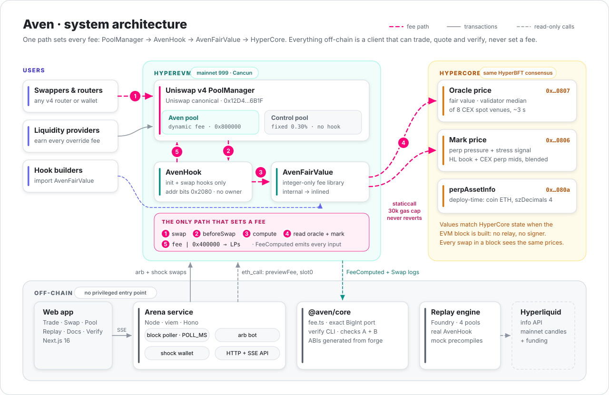
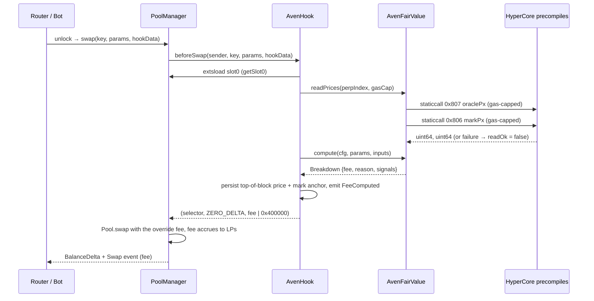
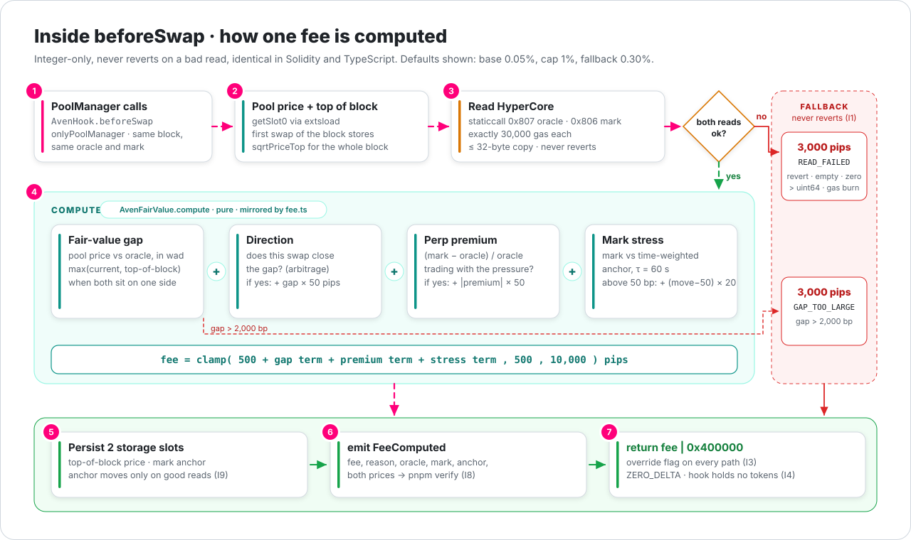
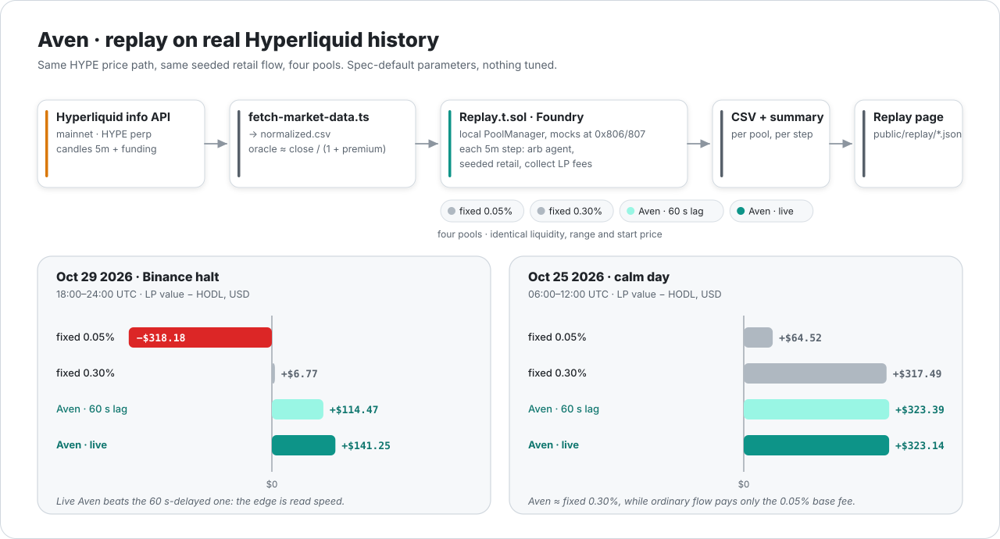
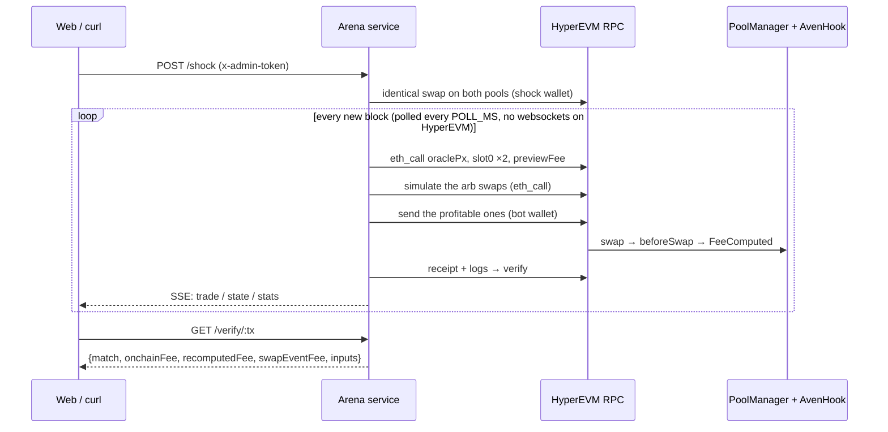
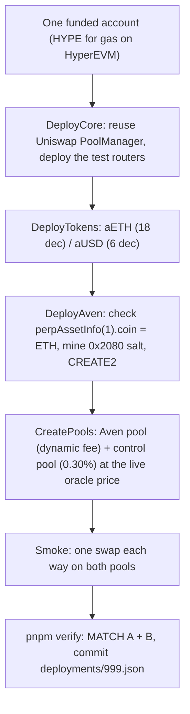

<div align="center">

<picture>
  <source media="(prefers-color-scheme: dark)" srcset="docs/diagrams/logo-dark.svg">
  
</picture>

### Every dynamic-fee hook trusts someone for its price. Aven reads the perp market itself.

**A Uniswap v4 fee library and hook on HyperEVM that prices every swap from Hyperliquid's in-block perp market, so LPs keep more of the value arbitrageurs would take.**

[](https://github.com/Uniswap/v4-core)
[](https://hyperevmscan.io/address/0xfdd13cA6D7FcF4Ca710Bc8C77546592F42CF6080)
[](contracts/foundry.toml)
[](docs/PROOFS.md)
[](LICENSE)

Built at **ETHGlobal Mumbai 2026** for the Uniswap Foundation track.

[How it works](#how-it-works) · [Proofs](#every-proof-and-what-it-catches) · [Run it](#getting-started) · [Integrate it](#integrate-aven-into-your-own-hook) · [Limits](#what-aven-does-not-claim)

</div>

---

> **Live on HyperEVM mainnet (chain 999)** since 2026-11-06, block 50,557,638.
> - `AvenHook` [`0xfdd13cA6D7FcF4Ca710Bc8C77546592F42CF6080`](https://hyperevmscan.io/address/0xfdd13cA6D7FcF4Ca710Bc8C77546592F42CF6080), on **Uniswap's own v4 PoolManager** [`0x12D4…6B1F`](https://hyperevmscan.io/address/0x12D4Fd9C5DeDd00ab8a0bCe2CF0167bbf94b6B1F).
> - Its first swaps read HyperCore's **real** oracle and mark in-block, and every fee can be recomputed: `CHAIN_ID=999 HYPEREVM_RPC=https://rpc.hyperliquid.xyz/evm pnpm verify <tx>`.
> - In the first live Arena test, the bot's arbitrage paid **9,950 pips on Aven vs 3,000 on the 0.30% control pool**, so **LPs kept $97.25 more** (demo tokens valued at the oracle). Details below; every address and transaction is in [docs/DEPLOYMENTS.md](docs/DEPLOYMENTS.md) §M.5.
>
> The contracts, TypeScript port, verifier, Arena bot service, replay engine, web app and every proof are done. Every number below says where it came from.

## What a judge should check

| Claim | Where to check it |
|---|---|
| It runs on **HyperEVM mainnet**, on Uniswap's canonical PoolManager, and the live bytecode is the audited build. | [hook on hyperevmscan](https://hyperevmscan.io/address/0xfdd13cA6D7FcF4Ca710Bc8C77546592F42CF6080) · [`contracts/deployments/999.json`](contracts/deployments/999.json) · [docs/DEPLOYMENTS.md](docs/DEPLOYMENTS.md) §M.5 |
| The fee comes from HyperCore's oracle and mark price, read **inside `beforeSwap`**, in the same block. No relay, keeper or signer. | [`AvenFairValue.readPrices`](contracts/src/AvenFairValue.sol#L122) · [`AvenHook._beforeSwap`](contracts/src/AvenHook.sol#L119-L146) |
| A broken price read **never reverts a swap**; it charges a fallback fee instead. | `test_precompileRevert_chargesFallback`, `test_precompileBurnsGas_capped`, `invariant_I1_noSwapRevertsFromReads` |
| A swap that closes a stale-price gap pays the gap fee; the same swap in the reverse direction doesn't. | `test_arbDirectionPaysMoreThanReverse`, `test_sandwichBackLeg_paysGapFee` |
| Every fee can be recomputed off-chain from the event alone, and the PoolManager charged exactly that fee. | [`pnpm verify <tx>`](backend/core/bin/verify.ts): check A (formula) + check B (`Swap.fee`) |
| Solidity and TypeScript give identical results. | `pnpm prove:diff`: **10,000 / 10,000** fee vectors, **2,000 / 2,000** anchor vectors, exact |
| On real Hyperliquid history (Oct 29 2026, Binance halt), Aven LPs beat fixed-fee LPs. | [Replay results](#replay-real-mainnet-history-four-pools) · [backend/data/replay/README.md](backend/data/replay/README.md) |
| No owner, setters, proxy, `receive` or custody. | [`AvenHook.sol`](contracts/src/AvenHook.sol): every config value is `immutable` |
| Anything that quotes Uniswap's dynamic-fee hooks can quote Aven. | `AvenHook` implements Uniswap's [`IDynamicFeeHook.getFee`](contracts/src/interfaces/IDynamicFeeHook.sol) |
| Uniswap's own **V4Quoter** and **Universal Router** (2.0 and 2.1.2) on mainnet route through the Aven pool, and the router delivers exactly the quote. | `pnpm health`: read-only, simulated with `eth_call` ([backend/scripts/health.ts](backend/scripts/health.ts)) |

---

## The whole story in three moves

1. **The leak.** An AMM's price only moves when someone trades against it. When the market moves somewhere else, the pool is stale, and the first arbitrageur to correct it profits at the LPs' expense. This is **loss-versus-rebalancing (LVR)**. A fixed fee taxes every trade the same and can't tell arbitrage from ordinary flow. Dynamic-fee hooks can, but they need a fresh, trustworthy outside price. On most chains that price arrives late (push oracles), costs a relayer per update (pull oracles), or comes from a model or operator you have to trust.

2. **The insight.** On HyperEVM, a contract can read HyperCore's perp **oracle price** and **mark price** through read precompiles (`0x…0807`, `0x…0806`). Hyperliquid's docs say these values *"match the latest HyperCore state at the time the EVM block is constructed."* HyperCore and HyperEVM share one consensus (HyperBFT), so the read has no relay, no signer and no cross-chain staleness. The fair price is already chain state.

3. **The fee.** Before every swap, Aven asks three questions. Is this trade closing a stale-price gap? Is it trading with perp-market pressure? Is the perp market moving violently? Each "yes" adds to the fee, which is clamped and paid to LPs. If the answer to all three is "no", the swap pays the 0.05% base fee. Every input is emitted in an event, so anyone can recompute the fee.

> Uniswap's own `VolatilePairHook` **learns from the pool's past**. Aven **reads the market's present**.

### Why it's different

| Design | Where the signal comes from | Trust | Admin / upgrade | Reacts |
|---|---|---|---|---|
| Fixed-fee pool | none | none | n/a | never |
| Push-oracle dynamic fee | oracle network | oracle operators | varies | after the update lands |
| Uniswap [`VolatilePairHook`](https://github.com/Uniswap/v4-hooks-public) | the pool's own top-of-block move (ask/bid skew + backrun fee) | pool path only | UUPS proxy with admin, pool-initializer and config-manager roles | after the pool itself moves |
| **Aven** | **HyperCore oracle + mark, read in-block** | **the chain only** | **none** | **same block, before the pool moves** |

Aven borrows four ideas from `VolatilePairHook`: top-of-block anchoring, direction-specific fees, implementing `IDynamicFeeHook.getFee`, and computing state in memory for views while only `beforeSwap` writes it. The two designs complement each other.

---

## How it works

### Architecture

<p align="center">
  <picture>
    <source media="(prefers-color-scheme: dark)" srcset="docs/diagrams/architecture-dark.svg">
    
  </picture>
</p>

**Trust boundary.** Only one path sets a fee: **PoolManager → AvenHook → AvenFairValue → HyperCore precompiles**. Everything off-chain is just a client. It can trade, quote, read and verify, but has no privileged entry point.

### A swap through the Aven pool



### The pricing model

All of the math is integer-only (no floats) and identical in Solidity and TypeScript. Fees are in pips (1,000,000 = 100%), and gaps are in basis points.

| Signal | What it measures | Charged when |
|---|---|---|
| **Fair-value gap** | how far the pool price is from the HyperCore oracle, anchored to the **top of the block** | the swap moves the pool *toward* fair, i.e. it's arbitrage |
| **Perp premium** | `(mark − oracle) / oracle`: buying or selling pressure in the perp market | the swap trades *with* that pressure |
| **Mark stress** | how far the mark moved against a **time-weighted anchor** (τ = 60 s) | the move exceeds 50 bp |

```text
fee = clamp( baseFee
           + (arb          ? gapBps      × gapWeight     : 0)
           + (withPressure ? |premiumBps| × premiumWeight : 0)
           + (moveBps > threshold ? (moveBps − threshold) × stressWeight : 0),
           minFee, maxFee )

bad read (revert, empty, zero, > uint64, gas burn)  →  fee = fallbackFee, reason = READ_FAILED
gapBps > maxGapBps                                   →  fee = fallbackFee, reason = GAP_TOO_LARGE
```

<p align="center">
  <picture>
    <source media="(prefers-color-scheme: dark)" srcset="docs/diagrams/fee-pipeline-dark.svg">
    
  </picture>
</p>

**Default parameters** ([`AvenFairValue.defaultParams`](contracts/src/AvenFairValue.sol#L84)), used everywhere. Nothing was tuned on the replay data.

| baseFee | minFee | maxFee | fallbackFee | gapWeight | premiumWeight | stressThreshold | stressWeight | τ | maxGap | precompileGas |
|---|---|---|---|---|---|---|---|---|---|---|
| 500 (0.05%) | 500 | 10,000 (1%) | 3,000 (0.30%) | 50 pips/bp | 50 pips/bp | 50 bp | 20 pips/bp | 60 s | 2,000 bp | 30,000 |

**Worked example** (from the spec). The pool is 1.50% above the oracle, the mark is 0.20% below the oracle, and the mark moved 0.30% against its anchor.
- **Seller (arbitrage):** 500 base + 150 bp × 50 gap + 20 bp × 50 premium + 0 stress = **9,000 pips (0.90%)**.
- **Buyer (same block, same state):** not arbitrage, and trading against the premium, so **500 pips (0.05%)**.

**Measured example** (Arena end-to-end test, local chain). A shock left both pools 164 bp above fair. The bot's arbitrage paid **500 + 164 × 50 = 8,700 pips on Aven** vs 3,000 on the control pool. The verifier recomputed 8,700 from the event.

### Two anti-gaming rules

- **Top-of-block gap anchor.** Without it, an arbitrageur could split one trade into many swaps in one block and pay a shrinking fee on each. With it, every arb-direction swap in the block pays at least the gap measured at the block's first swap. Tested by `test_splitSwapSameBlock_paysTopOfBlockGap`.
- **Time-weighted mark anchor.** A "previous swap" reference can be griefed: a dust swap just before the arb resets it and erases the stress fee. Aven's anchor moves by `dt / τ` no matter how many swaps happen, so a dust swap in the same second changes nothing. Tested by `test_dustSwap_doesNotResetStress`.

### Design rules that are never broken

- Every `beforeSwap` return sets `OVERRIDE_FEE_FLAG` (`0x400000`), the fallback included. A v4 dynamic-fee pool starts with a stored LP fee of 0, so a missing flag would mean free swaps.
- Hook permissions are `beforeInitialize` + `beforeSwap` only, so the hook address's low 14 bits are `0x2080`, mined with HookMiner.
- Precompile reads are hand-written, non-reverting `staticcall`s that forward exactly `precompileGas` and copy at most 32 bytes. hyper-evm-lib's `PrecompileLib` reverts on failure, so it is never used on the swap path. An invalid precompile call burns all the gas it's given, which is why the cap exists.
- `beforeInitialize` only accepts dynamic-fee pools of exactly the configured `{base, quote}` pair, so the hook can't be attached to a pair it would misprice.

---

## Every proof, and what it catches

A check that has never been seen failing doesn't prove much. The core checks were **mutation-tested**: we broke the code on purpose and confirmed the matching test went red.

<p align="center">
  <picture>
    <source media="(prefers-color-scheme: dark)" srcset="docs/diagrams/proofs-dark.svg">
    
  </picture>
</p>

| Run it | What it proves | Result | Seen failing on purpose? |
|---|---|---|---|
| `forge test` (in `contracts/`) | unit, fuzz (1,000 runs, fixed seed), v4 integration with **both token orders**, invariants | **90 passed, 0 failed, 5 skipped** (the skips are opt-in runs) | yes: no override flag → 5 tests fail; top-of-block reset every swap → 2 fail; anchor advancing on a failed read → 1 fails |
| the nine named tests (ARCHITECTURE §9) | split swaps, dust swaps, precompile revert, gas burn, wrong pair, static-fee pool, preview == charged, override flag, sandwich back leg | all pass, base as token0 **and** as token1 | — |
| `invariant_*` in [`AvenInvariant.t.sol`](contracts/test/invariant/AvenInvariant.t.sol) | I1, I2, I3, I4, I9 over random swaps, price moves, read failures, block changes | 64 runs × 64 calls, 0 reverts | yes: 3 mutations, each caught by the matching invariant |
| `pnpm prove:diff` | **I7**: Solidity `compute` ≡ TypeScript `compute` on every field | **10,000 / 10,000** fee + **2,000 / 2,000** anchor vectors | yes: 2 mutations caught |
| `pnpm verify <tx>` / `--all` | **I8**: fee recomputed from `FeeComputed` == event fee (check A) and == PoolManager `Swap.fee` (check B) | local chain: 2/2 smoke swaps; load test: **280/280** burst swaps and **348/348** under RPC faults | — |
| `pnpm --filter @aven/arena test:e2e` | live gate: shock → bot arbs both pools → Aven fee > control fee → LPs kept more → verify MATCH → trades reload after restart | PASS: Aven arb fee **8,700** vs **3,000**; **LPs kept $64.33 more** | — |
| `LOAD=1 forge test --match-path test/load/OnchainLoad.t.sol -vv` | 2,318 swaps over 250 blocks, ~15% of blocks with broken reads | **0 reverts**, 0 fee violations, 0 zero-fee swaps; all 387 fallback fees happened on broken reads | — |
| `pnpm --filter @aven/arena loadtest` | API under load with 200 SSE clients; bot under shocks with a flaky RPC | p99 ≤ 71 ms at ~1.5–2.5k req/s, 0 errors, no SSE leak; 0 nonce errors | found **4 bugs**, each fixed with a regression test ([LOADTEST.md](docs/LOADTEST.md)) |
| `pnpm proofs --e2e` | runs forge, the differential proof, local verify, the replay summary and the Arena e2e, then writes [docs/PROOFS.md](docs/PROOFS.md) | — | — |

### Invariants

| # | Invariant | Proven by |
|---|---|---|
| I1 | A swap never reverts because of a precompile read | unit + invariant (failure injection) |
| I2 | `fee ∈ [minFee, maxFee]`, or `fee == fallbackFee` with `reason ≠ OK` | fuzz + invariant |
| I3 | The override flag is set on every `beforeSwap` return | integration + invariant |
| I4 | The hook never holds tokens and returns `ZERO_DELTA` | invariant (balances 0) |
| I5 | No state-changing external function except `beforeInitialize` / `beforeSwap` (onlyPoolManager) | code review; `forge lint` (0 warnings in `src/`) |
| I6 | `previewFee(key, d).fee` == the fee charged, for the same pre-state | integration |
| I7 | Solidity `compute` == TypeScript `compute` on every vector | differential (10k vectors) |
| I8 | `FeeComputed` inputs are enough to recompute `fee` exactly | live verifier |
| I9 | The anchor changes only when both reads succeed; top-of-block changes only on the first swap of a block | unit + invariant |
| I10 | A pool with other currencies or a static fee can't initialize with the hook | unit |

### Gas

- **Hook overhead inside a real swap: 46,877 gas** (Aven swap 170,496 minus an identical control swap 123,619). That's with the mock precompile, which costs more than the real one (≤ 3,112 gas per read, measured on testnet).
- `AvenHook` runtime size: **9,337 bytes** (limit 24,576).
- About 16 Aven swaps fit in one 3M-gas HyperEVM small block.

### Replay: real mainnet history, four pools

The same HYPE price path (Hyperliquid mainnet data, 5-minute steps) runs through four otherwise identical pools in one local PoolManager. Each step, an arbitrage agent trades whenever it profits at the true oracle price, and a seeded retail agent makes the **same** trades on every pool.

<p align="center">
  <picture>
    <source media="(prefers-color-scheme: dark)" srcset="docs/diagrams/replay-dark.svg">
    
  </picture>
</p>

| Scenario | fixed 0.05% | fixed 0.30% | Aven, 60 s-delayed price | **Aven, live price** |
|---|---|---|---|---|
| **Oct 29 2026, 18:00–24:00 UTC (Binance halt)**: LP value − HODL | −$318.18 | +$6.77 | +$114.47 | **+$141.25** |
| Oct 25 2026, 06:00–12:00 UTC (calm): LP value − HODL | +$64.52 | +$317.49 | +$323.39 | +$323.14 |

- **In the Binance halt**, live Aven ends $141 above holding, while fixed 0.05% ends $318 below. The live hook beats the delayed one, so the edge comes from reading the market in-block.
- **On the calm day**, Aven roughly matches fixed 0.30% while charging ordinary flow only the 0.05% base fee. Live and delayed are about equal, because a 60 s lag doesn't matter when nothing moves.
- **Limits:** the historical oracle is approximated as candle close / (1 + hourly funding premium). The steps are 5 minutes because 1-minute candles are no longer served for these dates. With one arb attempt per step, absolute LVR is understated for every pool alike. Method, sanity tests and hand checks: [backend/data/replay/README.md](backend/data/replay/README.md).

---

## The Arena: a live arbitrage bot against two pools

The Arena is the live demo. A Node service runs an arbitrage bot against two pools with identical liquidity: a plain **0.30% control pool** and the **Aven pool**. An admin "shock" pushes both off fair value with the same swap. Then you watch what each pool charges the bot.



How the bot trades, per pool and per block:
1. Read the oracle and the pool price. Skip if the gap is under 1 bp.
2. Quote the fee: 3,000 on the control pool, `previewFee` on Aven.
3. Trade toward the break-even price `p* = oracle / (1 − f)` when selling base, or `oracle · (1 − f)` when buying.
4. Simulate first; send only if the trade is profitable at the oracle price.

It has a nonce manager per wallet, retries with backoff, trade-size caps, auto-pause on low gas balance, an admin token and rate limit on POST routes, and a CORS allowlist. On mainnet it also caps every transaction's gas price (`MAX_GAS_PRICE_GWEI`; above the cap the bot waits) and refuses to start without a real `NATIVE_USD` price and an admin token of at least 24 characters.

### First live run on HyperEVM mainnet (2026-11-07)

Real HyperCore oracle and mark, Uniswap's PoolManager, demo tokens `aETH` / `aUSD`. Source: [docs/DEPLOYMENTS.md](docs/DEPLOYMENTS.md) §M.5.

| Step | Result |
|---|---|
| Before | Oracle $2,228.00; both pools at $2,231.50 (15 bp) |
| **Shock**: 40,000 aUSD → aETH on both pools | both pools ~188 bp above the oracle ([Aven tx](https://hyperevmscan.io/tx/0x4f70aa22483255d5140d786afd0945c0d825303d84a2bea1844a6c049e80d4c1) · [control tx](https://hyperevmscan.io/tx/0xb14e2e882c4cf701ab022e22f68068e3a54cda4f38bbea8d9a45d3a63776f17f)) |
| **Bot arb, Aven pool** | **9,950 pips** = 500 + 186 bp gap × 50 + 3 bp premium × 50; verify **MATCH A + B** ([tx](https://hyperevmscan.io/tx/0xfce164020d09a93c06fc212d41e7a24abde051339aa4d9013ed26c86e5ba868f)) |
| **Bot arb, control pool** | 3,000 pips ([tx](https://hyperevmscan.io/tx/0xc0f7dfe4c58a0d0e2866d770798de177a79c3a6706b9e7c6d1c0f6745a81cd96)) |
| **Outcome** | LP fee income **$210.48 (Aven) vs $113.23 (control): LPs kept $97.25 more**. Bot profit $92.88 vs $297.77 |
| Gas | 4 txs, all succeeded, paid 0.10–0.12 gwei; the whole test cost **0.000083 HYPE** |

The Aven pool stays 97 bp off the oracle after the arb, because a further arb wouldn't cover its fee; the control pool ends 27 bp off.

### Arena HTTP + SSE API

Full types: [docs/spec/API.md](docs/spec/API.md). POST routes need the `x-admin-token` header.

| Method | Path | Returns |
|---|---|---|
| GET | `/health` | `{ok, chainId, block, botEnabled, version}` |
| GET | `/config` | `{chainId, hook, poolManager, pools, config, params, explorer}` |
| GET | `/state` | oracle, mark, and per-pool price, gap and next-fee preview |
| GET | `/stats` | per-pool trades, bot profit, LP fee income, volume; `lpKeptMoreUsd` |
| GET | `/trades?limit=50&pool=aven\|control` | `Trade[]`, newest first |
| GET | `/bot/status` | `{enabled, lastRunBlock, lastError, balances}` |
| GET | `/verify/:tx` | `VerifyResult` (checks A and B, every input) |
| GET | `/stream` | SSE events: `state`, `trade`, `shock`, `bot` |
| POST | `/shock` `{sizeBase?, direction?}` | `Shock` |
| POST | `/bot/start` · `/bot/stop` | `{enabled}` |
| POST | `/reset-stats` | `{since}` |

---

## Integrate Aven into your own hook

`AvenFairValue` is a library of `internal` functions, so it is inlined into whatever hook imports it. The minimal hook below compiles against this repo. It reads both prices without ever reverting, computes the fee and returns it with the override flag:

```solidity
import {AvenFairValue as FV} from "src/AvenFairValue.sol";

function _beforeSwap(address, PoolKey calldata key, SwapParams calldata sp, bytes calldata)
    internal override returns (bytes4, BeforeSwapDelta, uint24)
{
    (uint160 sqrtP,,,) = poolManager.getSlot0(key.toId());
    (bool ok, uint64 oracleRaw, uint64 markRaw) = FV.readPrices(cfg.perpIndex, params.precompileGas); // never reverts
    FV.Inputs memory inp = FV.Inputs({oracleRaw: oracleRaw, markRaw: markRaw, anchorMarkRaw: 0,
        sqrtPriceX96: sqrtP, sqrtPriceTopX96: sqrtP, zeroForOne: sp.zeroForOne, readOk: ok});
    uint24 fee = FV.compute(cfg, params, inp).fee;
    return (IHooks.beforeSwap.selector, BeforeSwapDeltaLibrary.ZERO_DELTA, fee | LPFeeLibrary.OVERRIDE_FEE_FLAG);
}
```

This sketch leaves out the two anti-gaming anchors (`anchorMarkRaw: 0` turns off the stress signal, and `sqrtPriceTopX96: sqrtP` turns off the top-of-block gap). For the full version, copy [`AvenHook._load`](contracts/src/AvenHook.sol#L187), which keeps both in two storage slots per pool. Validate your config with `FV.validateParams(cfg, params)` in the constructor.

**Quoting from a router or wallet.** `AvenHook` implements Uniswap's `IDynamicFeeHook`, so `getFee(key)` returns `(feeZeroForOne, feeOneForZero)` for the current block. `previewFee(key, zeroForOne)` returns the full `Breakdown` (gap, premium, stress, reason), and it equals what `beforeSwap` will charge in the same state (I6).

> **Integration note: add a gas margin.** The first swap of a block costs more, because it writes the top-of-block price and advances the anchor. `eth_estimateGas` may simulate the cheaper later-swap path, and the real transaction then runs out of gas. The load test hit this (12 of 70 bot txs reverted). The Arena uses estimate × 1.3 + 30k ([`withGasMargin`](backend/arena/src/chain.ts)), and routers should add a similar margin. This affects only the gas limit, never the fee.

### Where the Uniswap integration lives

| What | Where |
|---|---|
| `beforeSwap`: read, compute, persist, emit, return `fee \| OVERRIDE_FEE_FLAG` | [`contracts/src/AvenHook.sol#L119-L146`](contracts/src/AvenHook.sol#L119-L146) |
| `beforeInitialize`: dynamic fee + exact currency pair only | [`contracts/src/AvenHook.sol#L105`](contracts/src/AvenHook.sol#L105) |
| `previewFee` / `getFee` (`IDynamicFeeHook`) | [`#L151`](contracts/src/AvenHook.sol#L151) / [`#L160`](contracts/src/AvenHook.sol#L160) |
| `_load`: top-of-block, reads, anchor (in memory) | [`contracts/src/AvenHook.sol#L187`](contracts/src/AvenHook.sol#L187) |
| Gas-capped, non-reverting precompile reads | [`contracts/src/AvenFairValue.sol#L122`](contracts/src/AvenFairValue.sol#L122) |
| `compute`: the whole pricing model | [`contracts/src/AvenFairValue.sol#L178`](contracts/src/AvenFairValue.sol#L178) |
| `FeeComputed` event (every input) | [`contracts/src/interfaces/IAvenHook.sol#L23`](contracts/src/interfaces/IAvenHook.sol#L23) |
| BigInt port of `compute` / verifier | [`backend/core/src/fee.ts`](backend/core/src/fee.ts) / [`backend/core/src/verify.ts`](backend/core/src/verify.ts) |

---

## Tech stack

| Layer | Tools |
|---|---|
| Contracts | Solidity 0.8.26 (Cancun), Foundry, Uniswap **v4-core** (`d153b04`), **v4-periphery** (`c6e4754`, HookMiner), OpenZeppelin **uniswap-hooks** `BaseHook` (`v1.3.0-rc.0`), forge-std `v1.17.0`, hyper-evm-lib `v1.1` (tests only) |
| Chain | HyperEVM mainnet (999) on Uniswap's canonical v4 PoolManager; Hyperliquid mainnet data for the replay; HyperCore read precompiles `0x806` (mark), `0x807` (oracle), `0x80a` (perpAssetInfo) |
| Off-chain | Node ≥ 20, TypeScript (strict, ESM), pnpm workspaces, viem, zod, Hono + `@hono/node-server` (HTTP + SSE), vitest, tsx, autocannon (load tests) |
| Data | Hyperliquid info API (`candleSnapshot`, `fundingHistory`, `meta`) |
| Frontend | Next.js 16 (App Router), React 19, Tailwind CSS 4, viem, Privy (login), GSAP + three.js (motion), TradingView `lightweight-charts`; fees are re-verified in the browser with `@aven/core` |

## Project structure

```text
Aven/
├── contracts/                      Foundry
│   ├── src/
│   │   ├── AvenFairValue.sol       the library: reads, scaling, signals, fee, anchor
│   │   ├── AvenHook.sol            reference v4 hook (beforeInitialize + beforeSwap)
│   │   └── interfaces/             IAvenHook (FeeComputed, views), IDynamicFeeHook (Uniswap, MIT)
│   ├── script/                     DeployCore, DeployTokens, DeployAven, CreatePools, Smoke
│   ├── test/
│   │   ├── unit/ integration/ invariant/ load/ replay/ vectors/ recon/
│   │   ├── mocks/MockHyperCorePx.sol   etchable precompile mock with failure injection
│   │   └── utils/                  AvenTestBase, PriceMath
│   ├── deployments/                <chainId>.json, the single source of addresses
│   └── foundry.toml                default profile + v4core profile (canonical PoolManager build)
├── backend/
│   ├── core/       @aven/core: BigInt fee port, generated ABIs, pool + precompile reads, verifier, verify CLI
│   ├── arena/      @aven/arena: poller, arb bot, shock, stats, HTTP + SSE API, e2e + load tests
│   ├── scripts/    @aven/scripts: local chain, market data, replay, proofs report, demo
│   └── data/       raw/ (market data), replay/ (results), load/ (load-test output)
├── frontend/       @aven/web (Next.js): /, /trade, /swap, /pool, /replay, /docs, /verify/[tx];
│                   public/replay/*.json and public/arena-fallback.json are generated
└── docs/
    ├── spec/       ARCHITECTURE.md (normative), API.md, DATA.md, FRONTEND.md
    ├── PROOFS.md   SECURITY.md  LOADTEST.md  DEPLOYMENTS.md  DEMO.md  recon.md
    ├── FLOW.md     MEMORY.md    PLAN.md
    ├── diagrams/   README diagrams: render.py (stdlib Python) -> *-light.svg / *-dark.svg
    ├── ai/         PROMPTS.md, ATTRIBUTION.md
    └── planning/   pre-kickoff planning (ideas and specs only, no code)
```

How code flows from entry point to exit point, part by part: [docs/FLOW.md](docs/FLOW.md). The diagrams in this README are hand-built SVGs, in a light and a dark version; to change one, edit [docs/diagrams/render.py](docs/diagrams/render.py) and run `python docs/diagrams/render.py`.

---

## Getting started

### Prerequisites

- **Node ≥ 20** and **pnpm 12** (`packageManager: pnpm@12.9.1`)
- **Foundry** (`forge`, `anvil`, `cast`). Scripts also look in `~/.foundry/bin` if it isn't on `PATH`.
- `git` with submodules (contract dependencies are pinned submodules in `contracts/lib/`)

### Install

```bash
git clone --recurse-submodules https://github.com/SATISH-JALAN/Aven.git
cd Aven
# already cloned without submodules?  git submodule update --init --recursive
pnpm install
```

### Test everything

```bash
cd contracts && forge test && cd ..        # Solidity: unit, fuzz, integration, invariants
pnpm test                                  # TypeScript: core, arena, scripts
pnpm prove:diff                            # Solidity ≡ TypeScript on 10k + 2k vectors (~45 s)
pnpm --filter @aven/arena test:e2e         # full live gate on a local chain (~2.5 min)
pnpm proofs --e2e                          # forge + diff + local verify + replay + e2e -> docs/PROOFS.md
```

> **Check out the submodules before the first `forge test`.** If `contracts/lib/` is empty, forge tries to install the dependencies itself, can stop halfway, and then fails with `Source "lib/v4-core/..." not found`.

### Run the whole system locally (no keys, no funds)

```bash
pnpm --filter @aven/scripts local:once     # anvil + mock precompiles + all 5 deploy scripts + smoke swaps verified
pnpm --filter @aven/arena demo:local       # local chain + in-process Arena: shock -> bot -> stats -> verify
pnpm --filter @aven/arena check:frontend   # the web app's own swap + liquidity args on a local chain
```

> `demo:local` rewrites `frontend/public/arena-fallback.json`, which now holds the **mainnet** recording. Don't commit that file after a local run.

To keep a local chain running and point the Arena at it:

```bash
pnpm --filter @aven/scripts local:up       # stays up; writes contracts/deployments/31337.json
# then, with CHAIN_ID=31337, HYPEREVM_RPC=http://127.0.0.1:8545 and anvil accounts #1/#2 as BOT_PK/SHOCK_PK:
pnpm --filter @aven/arena start            # serves http://localhost:8787
```

### Run the web app

```bash
cp frontend/.env.example frontend/.env.local   # optional; defaults work
pnpm --filter @aven/web dev                    # http://localhost:3000
pnpm --filter @aven/web test                   # vitest
```

Without a reachable Arena, the app shows the recorded run (`public/arena-fallback.json`) and labels it as such. `/replay` plays the replay data. The verify page recomputes fees in the browser from the RPC receipt, without the Arena. See [frontend/README.md](frontend/README.md).

### Replay and verify

```bash
pnpm --filter @aven/scripts fetch-market-data   # Hyperliquid mainnet candles + funding -> backend/data/raw/
pnpm replay:binance-halt                        # four-pool replay -> backend/data/replay/*.csv, *.summary.json
pnpm replay:calm
pnpm --filter @aven/scripts replay-to-web       # -> frontend/public/replay/*.json

pnpm verify <txHash>                            # recompute the fee of every FeeComputed in a tx (exit 1 on mismatch)
CHAIN_ID=999 HYPEREVM_RPC=<rpc> pnpm verify --all   # every FeeComputed since deployment, in <= 50-block chunks
CHAIN_ID=999 pnpm health                         # read-only mainnet check: contracts, pools, Uniswap routers, recorded txs
```

The public RPC `https://rpc.hyperliquid.xyz/evm` allows 100 requests per minute per IP. That's fine for verifying a few transactions; use a dedicated endpoint for `--all` and for the Arena.

### Environment variables

Each tool reads its own folder's `.env`. Only the `.env.example` files are committed, and they hold placeholders.

| File | Variable | Purpose |
|---|---|---|
| `contracts/.env` | `DEPLOYER_PK` | deployer key for `forge script` |
| | `BOT_ADDRESS`, `SHOCK_ADDRESS` | wallets that receive test tokens |
| | `HYPEREVM_RPC` | chain RPC (a dedicated endpoint on mainnet); on 999 also `export PERP_INDEX=1 EXPECT_COIN=ETH` |
| `backend/.env` | `BOT_PK`, `SHOCK_PK` | Arena bot and shock wallet keys |
| | `ARENA_ADMIN_TOKEN` | required on POST routes (≥ 8 chars; ≥ 24 on mainnet) |
| | `ARENA_CORS_ORIGINS` | allowlist, default `http://localhost:3000` |
| | `HYPEREVM_RPC`, `HL_INFO_API_TESTNET`, `HL_INFO_API_MAINNET` | chain RPC and Hyperliquid info API |
| | optional: `CHAIN_ID` (998), `ARENA_PORT` (8787), `MAX_TRADE_BASE` (5), `MAX_TRADE_QUOTE` (10,000), `SHOCK_QUOTE` (40,000), `SHOCK_BASE` (15), `MIN_NATIVE_BALANCE` (0.01), `NATIVE_USD` (0), `POLL_MS` (500), `POST_RATE_LIMIT_PER_MIN` (30) | Arena tuning |
| | mainnet: `CHAIN_ID=999`, `NATIVE_USD` (HYPE price, must be > 0), `MAX_GAS_PRICE_GWEI` (required, e.g. 2), `POLL_MS=2000` on a free-tier RPC | see [docs/DEPLOYMENTS.md](docs/DEPLOYMENTS.md) §M.4 |
| `frontend/.env.local` | `NEXT_PUBLIC_ARENA_API`, `NEXT_PUBLIC_RPC` (default: public mainnet RPC), `NEXT_PUBLIC_CHAIN_ID` (default 999), `NEXT_PUBLIC_MODE` (`live` / `recorded`), `NEXT_PUBLIC_PRIVY_APP_ID` | public values only, never keys |

---

## Deployment (HyperEVM mainnet)

Aven runs on **HyperEVM mainnet (chain 999)** and reuses **Uniswap's canonical v4 PoolManager** there; it doesn't deploy its own. The hook is 9.3 KB, so it fits HyperEVM's 3M-gas small blocks: no big blocks and no HyperCore-user step. The deploy was rehearsed on a mainnet fork first, and an internal review was done before it ([docs/SECURITY.md](docs/SECURITY.md) §6). Full runbook: [docs/DEPLOYMENTS.md](docs/DEPLOYMENTS.md) §M.



- **Every transaction is capped at 2 gwei** (forge `--with-gas-price 2gwei`; Arena `MAX_GAS_PRICE_GWEI`). The base fee ranged from 0.10 to 10.8 gwei over 3 hours, so a capped tx waits rather than overpays.
- **Live asset: ETH** (mainnet perp index 1, `szDecimals` 4). The replay uses **mainnet HYPE** (index 159).
- **Demo tokens, real price.** The pools trade `aETH` / `aUSD` demo tokens (open mint, worth nothing), while the hook reads the **real** HyperCore ETH perp price. That works because the hook only needs the base asset's price, and both pools were initialized at it ($2,231.50 vs the oracle's $2,231.53).

**Deployed 2026-11-06, block 50,557,638.** 23 transactions, all succeeded, total cost 0.001044 HYPE (~$0.08).

| What | Address / tx |
|---|---|
| PoolManager (Uniswap's, reused) | [`0x12D4Fd9C5DeDd00ab8a0bCe2CF0167bbf94b6B1F`](https://hyperevmscan.io/address/0x12D4Fd9C5DeDd00ab8a0bCe2CF0167bbf94b6B1F) |
| **AvenHook** | [`0xfdd13cA6D7FcF4Ca710Bc8C77546592F42CF6080`](https://hyperevmscan.io/address/0xfdd13cA6D7FcF4Ca710Bc8C77546592F42CF6080): live code byte-identical to the audited build, address bits `0x2080` |
| Aven pool (dynamic fee) | `0x659c1cbd66a079592fd333ec44f76b4878aabfe5d9c17b7a14faaabbe7e0d1df` |
| Control pool (static 0.30%) | `0x4bf2e188c58f409792aae72afe12c7d025ce093d4ca92d8a100a810d8b1681b6` |
| aETH / aUSD | [`0xD4a2…5756`](https://hyperevmscan.io/address/0xD4a26168e47acc1b514aF23Fb5a360d171745756) / [`0xFC91…efd6`](https://hyperevmscan.io/address/0xFC91A98c4bDbF5b20a2Da89e514C66295051efd6) |
| PoolSwapTest / PoolModifyLiquidityTest | [`0xFe6b…02B1`](https://hyperevmscan.io/address/0xFe6baCe2E548fD06735A4242BBD46A3c842E02B1) / [`0x4da4…1A5b`](https://hyperevmscan.io/address/0x4da494CB3f82c3d01c2D720BB23B38E505141A5b) |
| Smoke swaps on Aven (verify MATCH A + B) | [`0x7b28…`](https://hyperevmscan.io/tx/0x7b28ee95600b0f2967542ec98b43f52435edab12a9ee6acf43e6c1306f337eed): 700 pips · [`0x2dd3…`](https://hyperevmscan.io/tx/0x2dd33f423c553cf4abd89af9ea725690039fb1105e883071a6c931bcea57f3a9): 500 pips; gas 190,521 / 174,097 |

The machine-readable record is [`contracts/deployments/999.json`](contracts/deployments/999.json). Testnet (998) was abandoned: nobody could get testnet HYPE (§T in DEPLOYMENTS.md).

### Production check (2026-11-07)

| Feature | What it does |
|---|---|
| **One-command mainnet health check** | `CHAIN_ID=999 pnpm health` is read-only: no key, nothing sent. It checks that the hook's code, permissions and settings match the deployment, that it runs on Uniswap's PoolManager with no protocol fee, and that live HyperCore prices are read. It also swaps both pools in both directions (simulated on live mainnet state) and re-verifies the 4 recorded Aven transactions. |
| **Routes through Uniswap v4** | The web app, the bot and the shock wallet all swap through `PoolSwapTest` into Uniswap's canonical PoolManager, which calls `AvenHook`. Uniswap's own **V4Quoter** and **Universal Router** (2.0 and 2.1.2) also route the Aven pool, and the router delivers exactly Uniswap's quote. |
| **Pump status on both pools** | The Pool page shows, per pool, "Pushed +N bp above the oracle" or "At the oracle", what last pushed it (a shock or a wallet swap), and the bot's arb back with the fee it paid. The Trade bar shows both pools' gaps. |
| **Mainnet by default** | The web app defaults to chain 999 and the public mainnet RPC, and bundles the mainnet addresses. |
| **Web3 sign-in** | "Connect wallet" through Privy, wallets only (MetaMask, Coinbase Wallet, Rainbow and others), no email. |
| **Everything green** | Typecheck in all 4 packages; Foundry 90 passed, 0 failed; all TypeScript tests; web production build (8 routes); the Arena end-to-end run; the web app's own swap and liquidity calls 30/30. |

Before the live demo, three things are still needed:
- Keep the Arena running and publicly reachable (with a dedicated RPC). Without it the site shows the recorded run and wallet swaps stay off.
- Set `NEXT_PUBLIC_PRIVY_APP_ID` on the host.
- Send one real swap and check it with `pnpm verify <tx>`.

---

## What Aven does not claim

- **The pools trade demo tokens.** `aETH` / `aUSD` have an open mint, so anyone can mint them and trade against the pools, including pushing a pool to the edge of its liquidity ([docs/SECURITY.md](docs/SECURITY.md) §6.2, C-5). The price the hook reads is real.
- **Numbers say where they came from.** The mainnet numbers are from the deploy and the first live Arena test. The proofs, load tests and the 8,700-pip Arena e2e ran on a local anvil chain with `MockHyperCorePx` at the precompile addresses.
- **The PoolManager has an owner.** On mainnet it's Uniswap's, owned by Uniswap governance. `protocolFeeController` is `0x0` today; if governance sets one, a protocol share could come out of LP fees, and verify check B would need to account for it ([docs/SECURITY.md](docs/SECURITY.md) §6.2, C-4).
- **The verifier proves the arithmetic, not the history.** It shows that the fee equals the formula applied to the logged inputs, and that the PoolManager charged exactly that fee. It does not prove that the logged oracle and mark equal HyperCore's history.
- **The replay is a simulation.** It uses a proxy for the oracle, 5-minute steps and one LP position per pool. It compares pools fairly against each other; it doesn't predict absolute returns.
- **Only assets with a HyperCore perp.** For Hyperliquid-native assets, the oracle may exclude external venues.
- **Splitting an arb across blocks lowers the fee somewhat.** The top-of-block anchor only covers one block. This is an accepted limitation; competing arbitrageurs take the first block.
- **No hedging and no LP management.** LPs still bear directional risk.
- **Parameters are calibrated, not optimized.** There is no third-party audit, only the internal pre-mainnet review in [docs/SECURITY.md](docs/SECURITY.md) §6. `slither` hasn't been run yet (it won't install on the build machine); `forge lint` gives 0 warnings in `src/`.

Threat model, each threat mapped to its test: [docs/SECURITY.md](docs/SECURITY.md).

## What was hard

- **Testnet was a dead end.** HyperEVM testnet has no v4 PoolManager, and ours (~24 KB) needs big blocks, which only a HyperCore user can switch on. Testnet HYPE for gas was unobtainable, since the faucet only serves addresses that have deposited on mainnet. So we went to mainnet, on Uniswap's own PoolManager, with every transaction capped at 2 gwei.
- **Forge can't simulate precompiles on a live chain.** A direct precompile read returns 0 bytes in forge's simulation, so `DeployAven` would have failed on mainnet. The internal review caught it, and the scripts now read through `vm.rpc`.
- **v4 tooling has moved.** `BaseHook` left v4-periphery (we use OpenZeppelin's), HookMiner moved to `test/shared/`, and v4-core's only tag (`v4.0.0`) predates `PoolOperation.sol`, so we pinned the commit OpenZeppelin pins.
- **The dynamic-fee zero trap.** A dynamic pool's stored LP fee is 0, so one missing override flag means free swaps. That's why I3 has a dedicated test, an invariant and a mutation check.
- **Precompile failure modes.** Reads can revert, return 0 bytes (local chains have no code there), return words wider than `uint64`, or burn all forwarded gas. Each mode has a test.
- **A 1-second-block chain exposes defaults.** The load tests found viem's ~4 s block-number cache, viem's 4 s receipt polling, a stampeding per-block cache, and gas estimates that miss the first-swap-of-block path. All four are fixed with regression tests.

---

## Team

| Name | GitHub |
|---|---|
| Sayan Roy | [@mesayanroy](https://github.com/mesayanroy) |
| Satish Jalan | [@SATISH-JALAN](https://github.com/SATISH-JALAN) |
| Om Kumar | [@iamomm-hack](https://github.com/iamomm-hack) |

## Disclosure

- **Pre-event planning.** The files in [docs/planning/](docs/planning/) were written **before kickoff**. They contain ideas and specs only, no code. The code was written during the event; the history starts with the bootstrap commit `5934448` on 2026-11-05.
- **AI use.** The AI coding assistant's prompts are logged verbatim in [docs/ai/PROMPTS.md](docs/ai/PROMPTS.md), and [docs/ai/ATTRIBUTION.md](docs/ai/ATTRIBUTION.md) lists every file it wrote or helped write.
- `contracts/src/interfaces/IDynamicFeeHook.sol` is a verbatim MIT copy of Uniswap's interface from `Uniswap/v4-hooks-public@c45509f`.

## License

[MIT](LICENSE)
