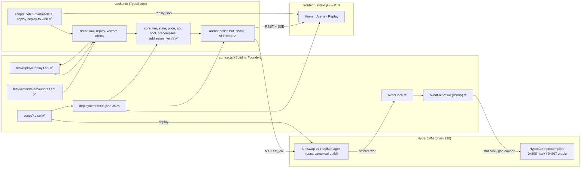

# FLOW.md — how code flows through Aven

How every part runs: where it **starts** (entry point), what it calls, and where it **ends** (exit point: output, event, file or response). Update this file in the same commit as any change that adds, moves or rewires code (AGENTS.md rule 4).

**Status:** ✅ exists in the repo · 🔜 planned (the build prompt that creates it). Section numbers (§) refer to [spec/ARCHITECTURE.md](spec/ARCHITECTURE.md).

_Last updated: 2026-11-06. Live Arena asset is testnet ETH (perp 4); tx links go to our own `/tx/<hash>` page (no testnet explorer). Only recon code exists so far._

---

## 0. The big picture

---

## 1. A swap through the Aven pool (the product, on-chain) ✅

**Entry:** any router calls `PoolManager.unlock()`. In the demo that's v4-core `PoolSwapTest.swap(key, params, testSettings, hookData)`; in production it's the Universal Router. The router's `unlockCallback` then calls `PoolManager.swap(key, SwapParams, hookData)` (`lib/v4-core/src/PoolManager.sol`).

1. `PoolManager.swap` → `Hooks.beforeSwap` (`lib/v4-core/src/libraries/Hooks.sol:263`). The pool's `key.fee == 0x800000` (dynamic), so the fee the hook returns will be used.
2. → `AvenHook.beforeSwap` (OZ `BaseHook`, `onlyPoolManager`) → `AvenHook._beforeSwap` (`contracts/src/AvenHook.sol`, P3).
3. → `_load(poolId)` (pure in-memory, §6.4):
   1. `getSlot0` via `extsload` gives the pool price `sqrtPriceX96`;
   2. top-of-block: if `block.number > topBlock`, store this price as `sqrtPriceTopX96`;
   3. `AvenFairValue.readPrices(perpIndex, precompileGas)` does gas-capped `staticcall`s to **0x807** (oracle) and **0x806** (mark). It never reverts; a bad read gives `readOk = false`;
   4. `AvenFairValue.compute(cfg, params, inputs)` runs §6.3 Steps 2–8: fallback, wad prices, gap with the top-of-block anchor, direction, premium, stress, then combine and clamp;
   5. the time-weighted mark anchor advances, only if `readOk`.
4. Write `PoolState` (2 slots) → emit **`FeeComputed`** (every input, §8.1).
5. Return `(beforeSwap.selector, ZERO_DELTA, fee | OVERRIDE_FEE_FLAG)`. The flag is always set (I3).
6. `Pool.swap` uses the override fee (`lib/v4-core/src/libraries/Pool.sol:303`), and the fee accrues to LPs (`feeGrowthGlobal`, input token).

**Exit:**
- the router settles the `BalanceDelta`;
- the PoolManager emits **`Swap(... fee)`**;
- the hook has emitted **`FeeComputed`**;
- the LPs' fee growth has increased.

**Failure exits, which never revert (I1):**
- a failed, empty or zero read gives `fee = fallbackFee`, `reason = READ_FAILED`;
- `gapBps > maxGapBps` gives `fallbackFee`, `reason = GAP_TOO_LARGE`.

The **control pool** (fee 3000, no hook) takes the same path minus steps 2–5.

## 2. Pool creation ✅ (hook checks; the testnet pool comes in P5)

- **Entry:** `PoolManager.initialize(key, sqrtPriceX96)`.
- **Path:** `Hooks.beforeInitialize` → `AvenHook._beforeInitialize`. It requires `key.fee == DYNAMIC_FEE_FLAG` (else `MustUseDynamicFee`) and `{currency0, currency1} == sorted(base, quote)` (else `WrongCurrencies`), then marks the pool initialized.
- **Exit:** the pool exists, with LP fee 0 (§2.3), or the call reverts (I10).

## 3. Quoting (read-only) ✅

- **Entry:** `AvenHook.getFee(key)` (`IDynamicFeeHook`) or `AvenHook.previewFee(key, zeroForOne)`. Called by routers, the Arena bot (`eth_call`) and the frontend.
- **Path:** `_load(poolId)` only; no storage writes. Unknown pool → `PoolNotInitialized`.
- **Exit:** `(feeZeroForOne, feeOneForZero)` or the full `Breakdown`. It equals what `beforeSwap` would charge in the same state (I6).

## 4. Deployment: scripts ✅, local chain ✅ (`pnpm local:once`), testnet run 🔜 (Sayan, docs/DEPLOYMENTS.md)

- **Entry:** `forge script` in `contracts/script/`. Keys come from `contracts/.env` (`DEPLOYER_PK`); `BOT_ADDRESS`/`SHOCK_ADDRESS` too. Shared plumbing is in `contracts/script/base/AvenScript.sol`; state between scripts goes in `deployments/<chainId>.wip.json`.
- **Path:**
  1. `FOUNDRY_PROFILE=v4core forge build lib/v4-core/src/PoolManager.sol` → `contracts/out-v4core/` (byte-identical to Uniswap's canonical build, recon A.5);
  2. the deployer is made a HyperCore user and switched to big blocks (recon B.6);
  3. `DeployCore.s.sol`: PoolManager from `out-v4core`, plus PoolSwapTest and PoolModifyLiquidityTest;
  4. switch big blocks off;
  5. `DeployTokens.s.sol`: **aETH** (18 dec) / aUSD (6 dec), minted to the deployer, bot and shock addresses;
  6. `DeployAven.s.sol`: checks `perpAssetInfo(4)` (`coin == "ETH"`, `szDecimals == 4`), mines a salt with HookMiner (flags `0x2080`), deploys through CREATE2 proxy `0x4e59…956C`;
  7. `CreatePools.s.sol`: initial price from `oraclePx`, Aven pool + control pool, identical liquidity;
  8. `Smoke.s.sol`: one swap each direction on both pools.
- **Exit:** **`contracts/deployments/998.json`** (§8.3). It's the single source of addresses for `backend/` and `frontend/`; tx links go into the docs.

## 5. Arena service (live demo bot) ✅ `backend/arena`

- **Entry:** `pnpm --filter @aven/arena start` (or `dev`) → `src/main.ts`:
  - `loadDotEnv` + `loadConfig` (zod: `src/config.ts`);
  - `loadDeployments(CHAIN_ID)`;
  - `makeChain` (`src/chain.ts`: viem with a nonce manager per wallet);
  - `new Arena(...).start()` (`src/arena.ts`: reloads `backend/data/arena/trades.jsonl`, approves the routers for bot and shock, starts the poller);
  - `makeApp` (`src/server.ts`, Hono) served on `ARENA_PORT`.

  Pure maths lives in `src/math.ts`; the API types are `src/types.ts` (= B4).
- **Path:** one process, three loops (§7.2):
  1. **Poller:** every ~500 ms, `eth_blockNumber` (no websockets on HyperEVM, recon B.2).
  2. **Bot loop**, per new block, per pool (control, aven):
     1. read the oracle with an `eth_call` to 0x807, and the pool price from slot0;
     2. skip if |gap| < 1 bp; otherwise pick the direction toward fair;
     3. quote the fee: 3000 for control, `previewFee` for Aven;
     4. compute the target price p* and the `sqrtPriceLimitX96`;
     5. `eth_call` to simulate, then send the swap from the **bot wallet** only if it's profitable at oracle;
     6. read the receipt, decode `FeeComputed`, verify it, then append a `Trade` to `trades.jsonl` and update the stats.
  3. **SSE broadcaster:** pushes `state`, `trade`, `shock` and `bot` events.
- **Admin entry:** `POST /shock` sends one identical swap on both pools from the **shock wallet**. Also `POST /bot/start`, `/bot/stop` and `/reset-stats`; all of these need `x-admin-token`.
- **Exit:**
  - REST JSON and the SSE stream to the frontend ([spec/API.md](spec/API.md));
  - swaps on chain;
  - `backend/data/arena/trades.jsonl`.

## 6. Verifier ✅ library (`backend/core/src/verify.ts`) + CLI (`backend/core/bin/verify.ts`)

- **Entry:** `pnpm verify <txHash>`, `pnpm verify --all` (`backend/core/bin/verify.ts`), or `GET /verify/:tx` on the Arena service.
- **Path:**
  1. fetch the receipt; decode each `FeeComputed` and its matching PoolManager `Swap` log;
  2. rebuild `Inputs`;
  3. recompute with `backend/core/src/fee.ts`;
  4. check A (recomputed == event fee) and check B (`Swap.fee` == expected).

  `--all` scans logs in ≤ 50-block chunks (recon B.3).
- **Exit:** MATCH or MISMATCH plus every intermediate value. The CLI prints them; the API returns them as JSON.

## 7. Differential proof (Solidity ≡ TypeScript) ✅

- **Entry:** `pnpm prove:diff` → `backend/core/scripts/prove-diff.ts`.
- **Path:** `contracts/test/vectors/GenVectors.t.sol` (`GEN_VECTORS=1`, fixed seed, 9 coverage classes, written line by line with `vm.writeLine`) → `backend/data/vectors/fee-vectors.json` + `anchor-vectors.json` → `backend/core/test/differential.test.ts` (vitest) recomputes each vector in TS.
- **Exit:** 10,000/10,000 fee vectors and 2,000/2,000 anchor vectors match, or the test fails (I7).

## 8. Replay (mainnet history, offline) ✅

- **Entry:** `pnpm replay:binance-halt` / `pnpm replay:calm` (root) → `backend/scripts/replay.ts`. The pre-step `src/replayPrep.ts` writes `backend/data/replay/<id>.input.json` (raw prices + the interpolated 60 s lag); then forge runs `test_replay_scenario` with `REPLAY_INPUT`/`REPLAY_CSV`/`REPLAY_SUMMARY`.
- **Path:**
  1. `pnpm --filter @aven/scripts fetch-market-data` (`backend/scripts/fetch-market-data.ts` → `src/marketData.ts`) reads `backend/scripts/scenarios.json`. It calls the Hyperliquid **mainnet** info API (`candleSnapshot`: 1m first, falling back to 5m, which is what's served for these dates; `fundingHistory` for the hourly premium). It writes `backend/data/raw/<scenario>/{candles,funding,meta}.json` + `normalized.csv` and `backend/data/raw/README.md` (source, time, method, limits);
  2. `contracts/test/replay/Replay.t.sol` runs a local PoolManager with 4 pools (fixed 0.05%, fixed 0.30%, Aven-delayed, Aven-live), `MockHyperCorePx` etched at 0x806/0x807, and per step `vm.warp`/`vm.roll`, an arb agent and a seeded retail agent;
  3. it writes `backend/data/replay/<scenario>.csv` + `.summary.json`;
  4. `backend/scripts/replay-to-web.ts` writes `frontend/public/replay/<scenario>.json`.
- **Exit:** CSV and summary files, plus the downsampled JSON that the Replay page loads.

## 9. Frontend 🔜P10

- **Entry:** a browser opens the Vercel URL. Next.js App Router pages: `/` (Home), `/arena`, `/replay`, and `/tx/[hash]`. That last one is our explorer stand-in: it shows the receipt and decoded `FeeComputed`/`Swap` from `NEXT_PUBLIC_RPC`, plus the verify result.
- **Path:**
  - Arena reads `NEXT_PUBLIC_ARENA_API` (`/config`, `/state`, `/stats`, `/trades`, `/stream` SSE, `/verify/:tx`);
  - direct chain reads go through `NEXT_PUBLIC_RPC` (wagmi/viem, chain 998);
  - Replay loads `frontend/public/replay/*.json`;
  - when the service is offline, the page shows `frontend/public/arena-fallback.json`, labelled "Recorded run";
  - admin buttons (`?admin=<token>`) POST to the backend.
- **Exit:** the rendered UI. Every number carries a source label and a badge.

## 10. Tests and checks

| Command (run in) | Entry file | What it proves | Status |
|---|---|---|---|
| `forge test --match-path "test/recon/*"` (`contracts/`) | `contracts/test/recon/Recon.t.sol` | v4 paths and constants, mock-etch plan, gas-cap containment | ✅ 7 pass, 1 skipped |
| `FORK_READ=1 forge test --match-test test_forkRead` (`contracts/`) | same | live testnet `perpAssetInfo` / mark / oracle reads | ✅ passes |
| `FOUNDRY_PROFILE=v4core forge build --sizes lib/v4-core/src/PoolManager.sol` (`contracts/`) | v4-core `PoolManager.sol` | canonical PoolManager, 24,009 B | ✅ |
| `pnpm --filter @aven/scripts local:once` | `backend/scripts/local-chain.ts` → `src/localChain.ts` | full §11.3 deploy on anvil (mock precompiles at 0x806/0x807/0x80a), smoke swaps, live verify A+B | ✅ 2/2 MATCH |
| `forge test --match-path test/unit/AvenFairValue.t.sol` (`contracts/`) | `contracts/test/unit/AvenFairValue.t.sol` | §6.2–§6.4 math, reads, I2 (fuzz, 1,000 runs, fixed seed) | ✅ 34 pass |
| `forge test --match-path test/integration/AvenHook.t.sol` (`contracts/`) | `contracts/test/integration/AvenHook.t.sol` (`AvenHookTest` base = token0, `AvenHookBaseToken1Test` base = token1) | all nine §9 named tests, I1/I3/I4/I6/I8/I9/I10, constructor validation via mined CREATE2, gas overhead | ✅ 20 + 20 pass |
| `forge test --match-path test/replay/Replay.t.sol` (`contracts/`) | `contracts/test/replay/Replay.t.sol` | sanity: flat → 0 trades and LVR 0; flat + retail → collected fees = expected (0.01%), fixed30 ≈ 6× fixed05. The scenario run is skipped unless `REPLAY_INPUT` is set | ✅ 2 pass |
| `forge test --match-path test/invariant/AvenInvariant.t.sol` (`contracts/`) | `contracts/test/invariant/AvenInvariant.t.sol` (`AvenHandler`: swap both directions, exact-in and exact-out / movePrice / setFailure / nextBlock) | I1, I2, I3, I4, I9 over 64 × 64 random calls; non-vacuity test | ✅ 5 invariants + 1 test |
| `forge snapshot` (`contracts/`) | `contracts/.gas-snapshot` | gas regression baseline (all but invariants) | ✅ |
| `pnpm test` (root) | `backend/core/test/{fee,differential,chain}.test.ts` | TS port mirrors the Solidity unit tests; vectors (skipped if absent); poolId/slot0/precompile decoding/§8.3 schema/verifier checks A and B | ✅ 29 pass |
| `pnpm prove:diff` (root) | `backend/core/scripts/prove-diff.ts` | I7: 10,000 fee + 2,000 anchor vectors, exact | ✅ |
| `pnpm verify <tx>` / `pnpm verify --all` (root; `CHAIN_ID`, `HYPEREVM_RPC`) | `backend/core/bin/verify.ts` | I8 per tx or for every FeeComputed since `deployedAtBlock` (≤ 50-block chunks) | ✅ local 2/2 |
| `pnpm proofs [--e2e]` (root) | `backend/scripts/proofs.ts` | runs every proof and writes `docs/PROOFS.md` | ✅ |
| `pnpm --filter @aven/scripts test` | `backend/scripts/test/{marketData,replayPrep}.test.ts` | premium forward-fill, oracleProxy, gaps, paging, 1m→5m fallback; raw conversion and lag interpolation | ✅ 9 pass |
| `pnpm --filter @aven/arena test` | `backend/arena/test/{math,server}.test.ts` | direction, p*, sqrtPriceLimit (both orders), valuation, stats; B4 routes, admin token, CORS, rate limit, SSE | ✅ 22 pass |
| `pnpm --filter @aven/arena test:e2e` | `backend/arena/test/e2e.test.ts` (E2E=1, local anvil chain) | PLAN 4.4 gate: shock → arbs → Aven fee > control → lpKeptMoreUsd > 0 → verify MATCH; persistence reload | ✅ 2 pass (~2.5 min) |
| `pnpm test` (frontend) | `frontend/` | UI | 🔜 P10 (teammate) |

## 11. What exists today ✅

- `contracts/src/AvenFairValue.sol`: the product library. `readPrices` makes gas-capped, non-reverting reads of 0x807/0x806 (assembly, 32-byte buffer); `oracleWad`/`poolWad` do the scaling; `compute` runs §6.3 Steps 2–8; `advanceAnchor` is §6.4; `defaultParams`/`validateParams` are §6.2.
- `contracts/test/mocks/MockHyperCorePx.sol`: etchable precompile mock. Price mode and perpAssetInfo mode; failure modes `setFail`/`setBurn`/`setEmpty`/`setOverflow`.
- `contracts/test/unit/AvenFairValue.t.sol`: 34 unit + fuzz tests (worked example, direction matrix, top-of-block, clamps, fallbacks, scaling, anchor, validation, read failures).
- `contracts/src/AvenHook.sol`: the reference hook (OZ BaseHook). Entry points: `beforeInitialize`/`beforeSwap` (PoolManager only), and the views `getFee`/`previewFee`/`poolState`/`config`/`params`. Internals: `_load` (top-of-block → reads → anchor), `_requireInitialized`, `_config`/`_params` (immutables → structs).
- `contracts/src/interfaces/IAvenHook.sol`: `PoolState`, the `FeeComputed` event, errors, views; it extends `IDynamicFeeHook`.
- `contracts/test/utils/AvenTestBase.sol`: v4 Deployers + mocks at 0x806/0x807 + a hook at a 0x2080 address + Aven/control pools; helpers `swapLogged`, `nextBlock`, `inputsOf`.
- `contracts/test/utils/PriceMath.sol`: `sqrtPriceFromWad` (inverse of `poolWad`; reused by CreatePools in P5).
- `contracts/src/interfaces/IDynamicFeeHook.sol`: Uniswap's quoting interface (verbatim MIT copy).
- `contracts/test/recon/Recon.t.sol`: recon checks (above).
- `contracts/foundry.toml`: `default` profile (our code + tests) and `v4core` profile (deployable PoolManager); RPC aliases `hyperevm_testnet` / `hyperevm_mainnet`.
- `contracts/lib/*`: pinned dependencies (recon A.1).
- `backend/core` (`@aven/core`):
  - `src/fee.ts`: exact BigInt port of AvenFairValue, plus `calculateSwapFee`;
  - `src/state.ts`: top-of-block and anchor rules, `load()` = `AvenHook._load`;
  - `src/price.ts`: `sqrtPriceFromWad`, `sqrtBig`, display helpers;
  - `src/abi.ts`: generated by `pnpm abi` (`scripts/gen-abi.ts`) from `contracts/out`: AvenHook, PoolManager, PoolSwapTest, PoolModifyLiquidityTest, MockERC20, MockHyperCorePx;
  - `src/pool.ts`: `poolId`, `poolStateSlot`, `decodeSlot0`, `readSlot0` (extsload);
  - `src/precompiles.ts`: `readOracleMark` (same readOk rule as Solidity), `readPerpAssetInfo` (one struct);
  - `src/addresses.ts`: zod §8.3 schema, `loadDeployments(chainId)`;
  - `src/verify.ts`: `verifyLogs` (pure), `verifyTx`, `verifyAll` (≤ 50-block chunks);
  - `scripts/prove-diff.ts`, `scripts/run.ts`: forge runner that adds `~/.foundry/bin` to PATH.
- `contracts/test/vectors/GenVectors.t.sol`: the vector generator (runs only with `GEN_VECTORS=1`).
- `backend/scripts` (`@aven/scripts`): `local-chain.ts` (entry: `pnpm local:up` keeps running, `local:once` exits) → `src/localChain.ts` `startLocalChain()`:
  1. anvil chain 31337 with 1 s blocks;
  2. etches `MockHyperCorePx` at 0x806/0x807/0x80a;
  3. runs the 5 forge scripts;
  4. returns `{publicClient, deployer/bot/shock accounts, deployments, setPrices(), setMockMode(), stop()}`;
  5. `verifySmoke()` verifies the smoke swaps.
- `contracts/deployments/README.md`: what lives there (`998.json` committed after the testnet run; `31337.json` and `*.wip.json` are gitignored).
- `frontend/`: README + `.env.example` only.
