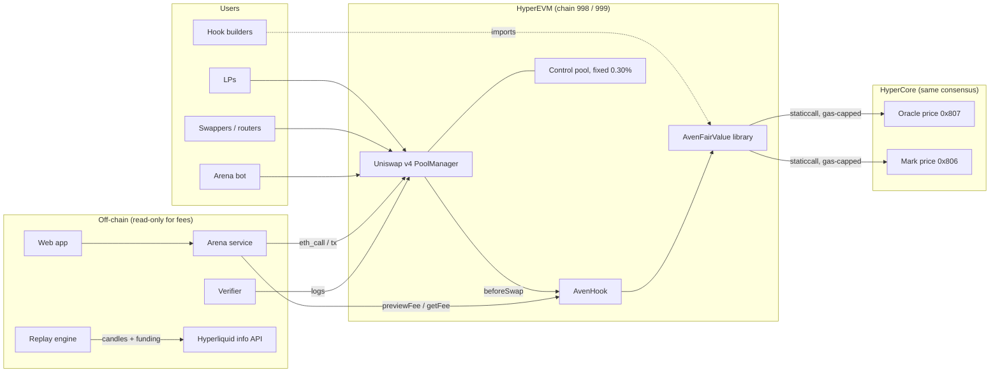
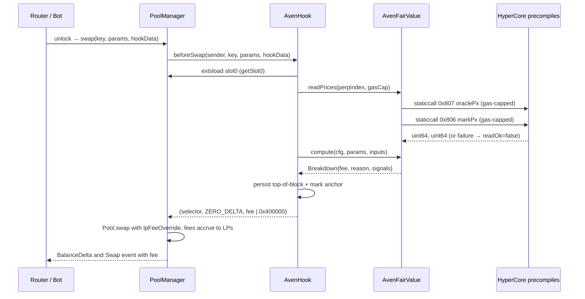
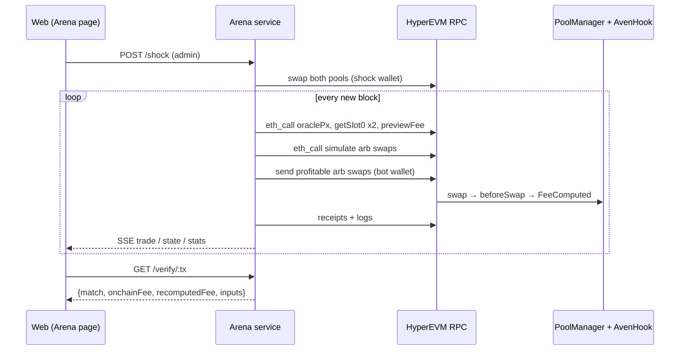
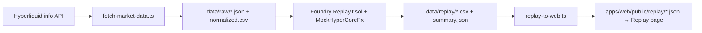
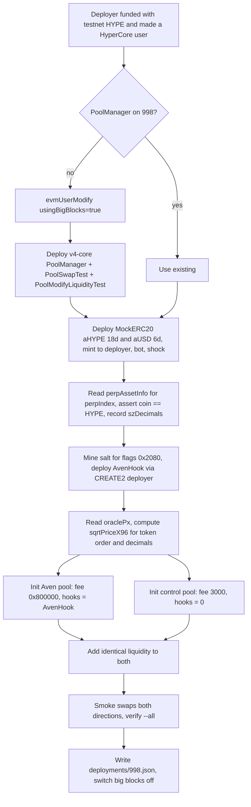

# Aven — Technical Architecture and System Design

**Version:** 1.0 · **Date:** 2026-11-05 · **Status:** Normative for the ETHGlobal Mumbai 2026 build
**Product:** Aven — a perp-aware dynamic-fee library and reference hook for Uniswap v4 on HyperEVM.

> **For Claude Code.** This document is the single source of truth for Aven's design. Where it conflicts with `docs/planning/aven-claude-code-prompts.md` Part B, **this document wins**. Words in capitals (MUST, MUST NOT, SHOULD, MAY) are requirements. Every external fact below was checked against the cited source or the upstream code (commits listed in §15). Anything marked **[RECON]** must be confirmed on the live chain before it is relied on, and the result written to `docs/recon.md`.

---

## Contents

1. Problem and goals
2. Uniswap v4: what Aven depends on
3. Hyperliquid: what Aven depends on
4. Prior art and positioning
5. System context and components
6. On-chain design (normative)
7. Off-chain design
8. Interfaces and data contracts
9. Verification strategy
10. Security model
11. Build, repo and deployment
12. Operations (demo runbook)
13. Known limitations and future work
14. Glossary
15. Sources and upstream versions

---

## 1. Problem and goals

### 1.1 Problem

A constant-function AMM quotes a price that only changes when someone trades against it. When the market price moves elsewhere, the pool is stale, and the first trader to correct it (an arbitrageur) profits at the LPs' expense. This loss is called **loss-versus-rebalancing (LVR)**. A fixed fee taxes every trade equally and can't tell arbitrage from ordinary flow. Dynamic-fee hooks can, but they need a fresh, trustworthy external price, and on most chains that price is either late (push oracles), costs a relayer per update (pull oracles), or comes from a model or operator you must trust.

### 1.2 Insight

On HyperEVM, a contract can read HyperCore's perp **oracle price** and **mark price** through read precompiles. The docs guarantee these values "match the latest HyperCore state at the time the EVM block is constructed." HyperCore and HyperEVM share the same HyperBFT consensus, so the read has no relay, no signer and no cross-chain staleness.

### 1.3 Goals

| ID | Goal |
|---|---|
| G1 | Charge swaps that close a stale-price gap a fee proportional to the gap, so LPs keep a share of the arbitrage |
| G2 | Keep ordinary (non-informed) flow at a low base fee |
| G3 | Widen fees during perp-market stress (fast mark moves) |
| G4 | Zero trusted parties: no owner, admin, keeper, signer, upgrade path or custody |
| G5 | Every fee is re-derivable off-chain from logged inputs |
| G6 | Adoptable: a library any v4 hook can import, plus a hook that implements Uniswap's `IDynamicFeeHook` quoting interface |
| G7 | A swap MUST never revert because of a price read |

### 1.4 Non-goals

Aven does not hedge LPs, place perp orders (CoreWriter is never called), hold funds, aggregate across perp DEXes, or manage liquidity ranges. It does not support assets without a HyperCore perp market.

---

## 2. Uniswap v4: what Aven depends on

Source: `Uniswap/v4-core` (commit `bea7f6d`, Oct 23 2026) and Uniswap developer docs.

### 2.1 Singleton and flash accounting
- One `PoolManager` holds every pool's state and tokens. Pools are identified by `PoolId = keccak256(abi.encode(PoolKey))`, where `PoolKey = {currency0, currency1, fee, tickSpacing, hooks}` and `currency0 < currency1`.
- Balance-changing calls (`swap`, `modifyLiquidity`, `donate`, `take`, `settle`, `sync`, `mint`, `burn`) only work inside `unlock()` → `unlockCallback()`. Deltas are tracked in transient storage and must net to zero before `unlock` returns. `initialize` does not need unlocking.
- v4 needs EIP-1153 transient storage (`evm_version = "cancun"`). HyperEVM runs Cancun (without blobs), so this works.

### 2.2 Hooks are selected by address bits
- The PoolManager calls a hook function only if the matching bit is set in the **hook contract's address**. Aven uses:

| Flag | Bit | Value |
|---|---|---|
| `BEFORE_INITIALIZE_FLAG` | 1 << 13 | `0x2000` |
| `BEFORE_SWAP_FLAG` | 1 << 7 | `0x0080` |

  So the hook address's low 14 bits MUST equal `0x2080`, and nothing else. Mine the CREATE2 salt with `HookMiner.find(deployer, flags, creationCode, constructorArgs)`. In current v4-periphery, HookMiner lives at `test/shared/HookMiner.sol`; older docs say `src/utils/HookMiner.sol`.
- In `forge script`, the deployer is the CREATE2 proxy `0x4e59b44847b379578588920cA78FbF26c0B4956C` **[RECON: deployed on chain 998?]**. In `forge test`, it's the test contract or the pranked address. Foundry's `deployCodeTo` can place a hook at any address in tests.
- `BaseHook` is no longer in v4-periphery; its README points to `Uniswap/v4-hooks-public`. Aven uses **OpenZeppelin `uniswap-hooks` `BaseHook`** (MIT, v1.3.0, `pragma ^0.8.26`, imports `@uniswap/v4-core/...`). Its constructor calls `Hooks.validateHookPermissions(this, getHookPermissions())`, so a wrong address reverts at deploy.
- `SwapParams` lives in `v4-core/src/types/PoolOperation.sol`: `{bool zeroForOne; int256 amountSpecified; uint160 sqrtPriceLimitX96}`. **Negative `amountSpecified` = exact input; positive = exact output.**
- Hook signature: `_beforeSwap(address sender, PoolKey calldata key, SwapParams calldata params, bytes calldata hookData) internal returns (bytes4, BeforeSwapDelta, uint24)`.
- If `msg.sender == address(hook)`, the PoolManager skips the hook (no self-calls).

### 2.3 Dynamic fees (exact semantics)
From `LPFeeLibrary.sol`, `Hooks.sol`, `Pool.sol`, `PoolManager.sol`:
- `DYNAMIC_FEE_FLAG = 0x800000` as `key.fee` marks a dynamic-fee pool. `getInitialLPFee` returns **0** for dynamic pools, so **a dynamic pool starts with a 0 LP fee**.
- The hook overrides the fee for one swap by returning `fee | OVERRIDE_FEE_FLAG` (`0x400000`) from `beforeSwap`. `Hooks.beforeSwap` reads the returned fee only `if (key.fee.isDynamicFee())`. `Pool.swap` uses it only `if (lpFeeOverride.isOverride())`, after `removeOverrideFlagAndValidate()`, which reverts if the fee is above `MAX_LP_FEE = 1_000_000`.
- **Consequence:** Aven MUST set the override flag on every return, including the fallback. Without it, the swap uses the stored LP fee, which is 0.
- The alternative, `poolManager.updateDynamicLPFee(key, fee)`, is callable only by the pool's hook and persists. Aven doesn't use it.
- Fees are in **pips** (1,000,000 = 100%). With a protocol fee: `swapFee = protocolFee + lpFee − protocolFee·lpFee/1e6`, with `MAX_PROTOCOL_FEE = 1000`. If `swapFee ≥ 1e6`, exact-output swaps revert, so Aven caps `maxFee` far below that.
- Order inside `Pool.swap`: snapshot `slot0` → resolve LP fee → max-fee check → zero-amount return → price-limit validation → step loop. Fees accrue as `feeGrowthGlobal += feeAmount·2^128 / liquidity`, on the **input token**.
- `PoolManager` emits `Swap(PoolId indexed id, address indexed sender, int128 amount0, int128 amount1, uint160 sqrtPriceX96, uint128 liquidity, int24 tick, uint24 fee)`, where `fee` is the total swap fee. The verifier uses this as a second, independent check.

### 2.4 Reading pool state
`StateLibrary.getSlot0(manager, poolId)` returns `(sqrtPriceX96, tick, protocolFee, lpFee)` via `extsload`, with no unlock needed.

### 2.5 Uniswap's own quoting interface
`v4-hooks-public/src/interfaces/IDynamicFeeHook.sol`:
```solidity
interface IDynamicFeeHook {
    error PoolNotInitialized(PoolId poolId);
    /// The LP fee a swap would be charged this block, per direction. MUST be size-independent.
    function getFee(PoolKey calldata key) external view returns (uint24 feeE6ZeroForOne, uint24 feeE6OneForZero);
}
```
Aven's fee doesn't depend on swap size, so `AvenHook` implements this interface. Anything that already quotes Uniswap's dynamic-fee hooks can quote Aven.

### 2.6 Deployments
- **HyperEVM mainnet (999):** PoolManager `0x12D4Fd9C5DeDd00ab8a0bCe2CF0167bbf94b6B1F`, PositionManager `0x0d7Ab5B3db668128Aff6F70C4eBC71D7d4DA9bf9`, StateView `0x1656326235cb9E34Cb58CaDe53AE30789AB32A1A`, V4Quoter `0x108Bfe38532C98f8Cd8D7Ab49c9dDAa3675a1c5e`, Universal Router `0x9aFe3C497e19501DB228F28CdBdD29bC98F65DBa` (2.1.2: `0xeD270A1Bcdc63cf1356D695e7f40961d4819d6bF`), Permit2 `0x000000000022D473030F116dDEE9F6B43aC78BA3`.
- **HyperEVM testnet (998):** not listed in Uniswap's deployments. **Plan: deploy our own v4-core PoolManager plus test routers [RECON: confirm none exists].**

### 2.7 Test utilities (v4-core `src/test`, `test/utils`)
`PoolSwapTest.swap(key, params, TestSettings{takeClaims, settleUsingBurn}, hookData)`, `PoolModifyLiquidityTest.modifyLiquidity(key, params, hookData)`, and `Deployers` helpers (`deployFreshManagerAndRouters`, `deployMintAndApprove2Currencies`, `initPool`, `initPoolAndAddLiquidity`, `swap`). v4-core builds with `solc 0.8.26`, `via_ir = true`, `optimizer_runs = 44444444`, `evm_version = cancun`.

---

## 3. Hyperliquid: what Aven depends on

Source: Hyperliquid docs (gitbook) and `hyperliquid-dev/hyper-evm-lib` (commit `4eb7ab0`).

### 3.1 One chain, two execution layers
- **HyperBFT** (a HotStuff variant) secures a single state containing **HyperCore** (on-chain order books, margining, oracle) and **HyperEVM** (general EVM). Validators produce blocks in proportion to stake. HyperCore runs ~200k orders/s, with 0.2s median end-to-end latency for co-located clients.
- **HyperEVM:** mainnet chain 999 (`https://rpc.hyperliquid.xyz/evm`), testnet chain 998 (`https://rpc.hyperliquid-testnet.xyz/evm`). Gas token HYPE (18 decimals). EIP-1559 is on, and **both base and priority fees are burned**. **The official RPC has no websocket support**, so off-chain services must poll.
- **Dual blocks:** small blocks every 1s with 3M gas; big blocks every 1 minute with 30M gas. A user opts into big blocks with HyperCore action `{"type":"evmUserModify","usingBigBlocks":true}`, and must already be a HyperCore user (an address becomes one by receiving a Core asset such as USDC). Large deployments, like a PoolManager, go through big blocks.
- **Ordering within an L1 block:** L1 block → EVM block → EVM→Core transfers → CoreWriter actions. Core→EVM transfers queue until the next EVM block.

### 3.2 Read precompiles (what the hook reads)

| Precompile | Address | Input | Output |
|---|---|---|---|
| markPx | `0x…0806` | `abi.encode(uint32 perpIndex)` | `uint64` |
| oraclePx | `0x…0807` | `abi.encode(uint32 perpIndex)` | `uint64` |
| l1BlockNumber | `0x…0809` | empty | `uint64` |
| perpAssetInfo | `0x…080a` | `abi.encode(uint32 perpIndex)` | `(string coin, uint32 marginTableId, uint8 szDecimals, uint8 maxLeverage, bool onlyIsolated)` |
| bbo | `0x…080e` | `abi.encode(uint64 asset)` | `(uint64 bid, uint64 ask)` |

- **State:** values match the latest HyperCore state when the EVM block is constructed, so every swap in one EVM block sees the same oracle and mark.
- **Scaling (perps):** human price = `raw / 10^(6 − szDecimals)`. hyper-evm-lib's `normalizedMarkPx` = `markPx · 10^szDecimals` (6-decimal fixed point), which is the same rule.
- **Gas:** `2000 + 65 × (input_len + output_len)`. A price read is 32 bytes in and 32 out, so 6,160 gas plus call overhead.
- **Errors:** invalid input "will return an error and consume all gas passed into the precompile call frame." **Aven MUST cap the gas forwarded to every precompile call.**
- **CoreWriter** (`0x3333…3333`) is not used. Order and vault actions from it are delayed on-chain by a few seconds, so a hook can't hedge atomically.

### 3.3 How the two prices are built
- **Oracle price:** validators publish about every 3 seconds. Each takes a weighted median of spot mids from Binance (3), OKX (2), Bybit (2), Kraken, KuCoin, Gate IO, MEXC and Hyperliquid (1 each). The final value is a stake-weighted median across validators. For assets whose main spot liquidity is on Hyperliquid, external sources are excluded until there is enough liquidity. **Aven uses this as fair value.**
- **Mark price:** the median of three inputs: (a) oracle + 150-second EMA of (Hyperliquid mid − oracle); (b) median of Hyperliquid best bid, best ask and last trade; (c) weighted median of Binance, OKX, Bybit, Gate IO and MEXC perp mids (3, 2, 2, 1, 1). It updates when the oracle updates (~3s) and is used for margining, liquidations and TP/SL. **Aven uses mark − oracle as perp-market pressure, and mark movement as stress.** (Correction to earlier planning notes: mark is not only Hyperliquid's book; it blends Hyperliquid and major CEX perp markets.)
- **Funding:** the premium is sampled every 5 seconds from impact bid/ask vs oracle, averaged hourly, paid hourly, and capped at 0.5%/hour. The replay uses the recorded premium to reconstruct an oracle proxy.

### 3.4 Off-chain data (Hyperliquid info API)
`POST https://api.hyperliquid.xyz/info` (testnet `https://api.hyperliquid-testnet.xyz/info`):
- `{"type":"meta"}` returns the perp universe. **perpIndex = position in `universe`**; `szDecimals` per asset.
- `{"type":"candleSnapshot","req":{"coin","interval","startTime","endTime"}}` returns up to ~5,000 candles per response; page using the last close time + 1 ms.
- `{"type":"fundingHistory","coin","startTime","endTime"}` returns `{coin, fundingRate, premium, time}`.

### 3.5 hyper-evm-lib (testing aid)
- `PrecompileLib` wraps all reads, but **reverts** on failure. Aven MUST NOT call it from the swap path; it uses its own non-reverting, gas-capped reads.
- `CoreSimulatorLib.init()` etches simulators at every precompile and can read **real** values over `vm.rpc("eth_call", …)` in fork mode. It exposes `setMarkPx` but no oracle setter, so Aven's unit tests use their own `MockHyperCorePx`. A fork-read test MAY use the `vm.rpc` pattern to check scaling against live values.

---

## 4. Prior art and positioning

| Design | Where the signal comes from | Trust | Upgradeable / admin | Reacts |
|---|---|---|---|---|
| Fixed-fee pool | none | none | n/a | never |
| Push-oracle dynamic fee | oracle network | oracle operators | varies | after the update lands |
| **Uniswap `VolatilePairHook`** (v4-hooks-public; OpenZeppelin audit 10/14/2026; live on Ethereum ETH/USDC since 10/13/2026 and Robinhood Chain since 10/28/2026; no HyperEVM deployment listed) | the pool's own top-of-block price move: ask/bid skew plus a backrun fee | pool path only | **UUPS proxy with admin, pool-initializer and config-manager roles (timelock on Robinhood)** | after the pool itself moves |
| OniBlock (ETHGlobal Tokyo 2026, Uniswap 3rd) | AI-set fee sensitivity with on-chain Brier score | model + settler | yes | per block via model |
| KyberSwap FairFlow | hook on v4 and similar that redistributes arbitrage value to LPs | Kyber's design | check docs | check docs |
| **Aven** | **HyperCore oracle + mark read in-block** | **chain only** | **none** | **same block, before the pool moves** |

**The difference in one line:** Uniswap's own volatile-pair hook learns from the pool's past; Aven reads the market's present.

**Ideas we adopt from `VolatilePairHook`:**
- (a) top-of-block anchoring, so splitting a trade inside a block doesn't lower its fee;
- (b) direction-specific fees;
- (c) implementing `IDynamicFeeHook.getFee`;
- (d) computing state in memory for views and persisting only in `beforeSwap`.

These are complementary designs: a pool could combine Aven's external fair value with VolatilePairHook's skew. That is future work.

---

## 5. System context and components

### 5.1 Context



### 5.2 Components

| Component | Kind | Responsibility | Can change a fee? |
|---|---|---|---|
| `AvenFairValue` | Solidity library (internal functions) | Gas-capped reads, price normalisation, signals, fee | defines it |
| `AvenHook` | v4 hook (OZ BaseHook) | Validates pools, keeps per-pool state, returns the override fee, emits `FeeComputed`, exposes `getFee` / `previewFee` | applies it |
| Control pool | v4 pool, static 3000 pips, no hook | Baseline for Arena | no |
| `MockHyperCorePx` | test-only contract etched at 0x806 / 0x807 | Deterministic prices and failure injection | no |
| `packages/core` | TypeScript | BigInt port of the fee math, ABIs, precompile reads, verifier | no |
| Arena service | Node, TypeScript | Bot loop, shock, stats, HTTP + SSE API | no (trades like any user) |
| Web app | Next.js | Home, Arena, Replay | no |
| Replay engine | Foundry | Offline 4-pool simulation over historical data | no |

### 5.3 Trust boundaries
The only path that determines a fee is **PoolManager → AvenHook → AvenFairValue → HyperCore precompiles**. Everything off-chain is a client: it can trade, quote, read and verify, but has no privileged entry point.

---

## 6. On-chain design (normative)

### 6.1 Contract inventory

| Contract | File | Notes |
|---|---|---|
| `AvenFairValue` | `contracts/src/AvenFairValue.sol` | library; `internal` functions only, so it's inlined into importing hooks |
| `AvenHook` | `contracts/src/AvenHook.sol` | one instance per (perp, base token, quote token) |
| `IAvenHook` | `contracts/src/interfaces/IAvenHook.sol` | extends `IDynamicFeeHook` |
| `IDynamicFeeHook` | `contracts/src/interfaces/IDynamicFeeHook.sol` | local MIT copy of Uniswap's interface (§2.5), so we don't depend on v4-hooks-public |
| `MockHyperCorePx` | `contracts/test/mocks/MockHyperCorePx.sol` | tests only |

### 6.2 Types

```solidity
library AvenFairValue {
    address internal constant MARK_PX   = 0x0000000000000000000000000000000000000806;
    address internal constant ORACLE_PX = 0x0000000000000000000000000000000000000807;
    uint256 internal constant Q96 = 2 ** 96;

    struct Config {
        uint32 perpIndex;     // HyperCore perp index of the base asset
        uint8  szDecimals;    // HyperCore szDecimals for that perp (<= 6)
        bool   baseIsToken0;  // base token is currency0 of the PoolKey
        uint8  decimals0;     // ERC20 decimals of currency0
        uint8  decimals1;     // ERC20 decimals of currency1
    }

    struct Params {
        uint24 baseFee;            // calm fee, pips
        uint24 minFee;             // floor, pips
        uint24 maxFee;             // ceiling, pips
        uint24 fallbackFee;        // charged on a bad read, pips
        uint32 gapWeight;          // pips per bp of gap, arb direction only
        uint32 premiumWeight;      // pips per bp of |premium|, with-pressure only
        uint32 stressThresholdBps; // mark move that counts as stress
        uint32 stressWeight;       // pips per bp above threshold
        uint32 stressTauSec;       // time constant of the mark anchor
        uint32 maxGapBps;          // above this the read is treated as bad
        uint32 precompileGas;      // gas forwarded to each precompile call
    }

    struct Inputs {               // everything the fee depends on (all emitted)
        uint64  oracleRaw;
        uint64  markRaw;
        uint64  anchorMarkRaw;    // mark anchor BEFORE this swap's update (0 = none)
        uint160 sqrtPriceX96;     // pool price before the swap
        uint160 sqrtPriceTopX96;  // pool price at top of this block
        bool    zeroForOne;
        bool    readOk;
    }

    enum Reason { OK, READ_FAILED, GAP_TOO_LARGE }

    struct Breakdown {
        uint24 fee;
        Reason reason;
        uint256 gapBps;
        int256  premiumBps;
        uint256 moveBps;
        bool arb;
        bool withPressure;
    }
}
```

**Default `Params`:**

| Field | Default | Rationale |
|---|---|---|
| baseFee | 500 (0.05%) | competitive calm-market fee |
| minFee | 500 | floor = base |
| maxFee | 10,000 (1.00%) | bounds manipulation impact; far below exact-out limits |
| fallbackFee | 3,000 (0.30%) | standard Uniswap tier |
| gapWeight | 50 | 50 pips per bp: arbs pay about half the gap |
| premiumWeight | 50 | same scale for perp pressure |
| stressThresholdBps | 50 | 0.5% mark move against the anchor counts as stress |
| stressWeight | 20 | 0.002% per bp above threshold |
| stressTauSec | 60 | anchor time constant |
| maxGapBps | 2,000 | a 20% gap is treated as a bad read |
| precompileGas | 30,000 | about 5× the precompile cost; bounds gas burn on failure |

**Constructor validation (MUST revert `InvalidParams`):** `minFee ≤ baseFee ≤ maxFee`; `minFee ≤ fallbackFee ≤ maxFee`; `maxFee ≤ 100_000`; `stressTauSec > 0`; `maxGapBps > 0`; `precompileGas ≥ 10_000`; `szDecimals ≤ 6`; `currency0 < currency1`; base and quote are distinct and not native; `baseIsToken0 == (base == currency0)`.

### 6.3 Pricing model

All math is integer. Unsigned division floors; signed division truncates toward zero (Solidity `int` and TypeScript `BigInt` behave the same). `mulDiv` = v4-core `FullMath.mulDiv` (512-bit, floor).

**Step 1 — reads.** `readOk` is true iff both staticcalls succeed, each return is ≥ 32 bytes, and both decoded `uint64` values are > 0. Each call forwards exactly `precompileGas`. The function MUST NOT revert.

**Step 2 — fallback on bad read.** If `!readOk` → `fee = fallbackFee`, `reason = READ_FAILED`, all signals 0.

**Step 3 — prices in wad (1e18).**
- `oracleWad = oracleRaw · 10^(12 + szDecimals)`, which is exactly `raw·1e18 / 10^(6 − szDecimals)`.
- `poolWad(sqrtP)`, the base token's price in quote token, decimals-adjusted:
  - if `baseIsToken0`:
    `pX96 = mulDiv(sqrtP, sqrtP, Q96)`
    `poolWad = mulDiv(pX96, 10^(18 + decimals0), 10^decimals1 · Q96)`
  - else:
    `a = mulDiv(10^(18 + decimals1), Q96, sqrtP)`
    `poolWad = mulDiv(a, Q96, sqrtP · 10^decimals0)`
- `curWad = poolWad(sqrtPriceX96)`, `topWad = poolWad(sqrtPriceTopX96)`.

**Step 4 — gap with top-of-block anchor.**
- `gapCur = |curWad − oracleWad| · 10000 / oracleWad`, `gapTop = |topWad − oracleWad| · 10000 / oracleWad`
- `above = curWad > oracleWad`, `below = curWad < oracleWad`
- `topSameSide = (above && topWad > oracleWad) || (below && topWad < oracleWad)`
- `gapBps = topSameSide ? max(gapCur, gapTop) : gapCur`
- If `gapBps > maxGapBps` → `fee = fallbackFee`, `reason = GAP_TOO_LARGE` (gapBps still reported).

*Why the anchor:* without it, an arbitrageur could split one trade into many swaps in the same block and pay a shrinking fee on each. With it, every arb-direction swap in the block pays at least the top-of-block gap. This mirrors `VolatilePairHook`'s top-of-block state.

**Step 5 — direction.**
- `sellingBase = baseIsToken0 ? zeroForOne : !zeroForOne`
- `arb = (above && sellingBase) || (below && !sellingBase)`. If the pool is exactly at fair, `arb = false`.

**Step 6 — perp pressure.**
- `premiumBps = (int(markRaw) − int(oracleRaw)) · 10000 / int(oracleRaw)` (raw values share scaling, so it cancels).
- `withPressure = (premiumBps > 0 && !sellingBase) || (premiumBps < 0 && sellingBase)`.

**Step 7 — stress against a time-weighted mark anchor.**
- `moveBps = anchorMarkRaw == 0 ? 0 : |markRaw − anchorMarkRaw| · 10000 / anchorMarkRaw`.

**Step 8 — combine and clamp.**
```
raw = baseFee
    + (arb          ? gapBps × gapWeight : 0)
    + (withPressure ? |premiumBps| × premiumWeight : 0)
    + (moveBps > stressThresholdBps ? (moveBps − stressThresholdBps) × stressWeight : 0)
fee = min(max(raw, minFee), maxFee)          // computed in uint256
reason = OK
```

**Worked example** (base = token0; pool 1.50% above oracle; mark 0.20% below oracle; mark moved 0.30% vs anchor):
- **Seller (arbitrage):** gap 150 bp × 50 = 7,500; selling with negative premium → 20 × 50 = 1,000; stress 30 < 50 → 0. Fee = 500 + 7,500 + 1,000 = **9,000 pips (0.90%)**.
- **Buyer (same state):** not arb; buying against negative premium → no pressure fee. Fee = **500 pips (0.05%)**.

### 6.4 State and its update rules

Per pool, two storage slots:
```solidity
struct PoolState {
    uint64  topBlock;         // block.number of the stored top-of-block price
    uint160 sqrtPriceTopX96;  // pool price at the first swap of topBlock     (slot 1: 224 bits)
    uint64  anchorMark;       // time-weighted mark anchor (raw)
    uint40  anchorTime;       // block.timestamp of last anchor update        (slot 2: 104 bits)
    bool    initialized;      // set in beforeInitialize
}
mapping(PoolId => PoolState) internal _state;
```

`_load(poolId) view → (PoolState advanced, Inputs, Breakdown)` computes everything in memory without writing:
1. `(sqrtP,,,) = poolManager.getSlot0(poolId)`.
2. **Top of block:** if `block.number > s.topBlock`, then `s.topBlock = block.number; s.sqrtPriceTopX96 = sqrtP`.
3. Read prices (Step 1), then `inputs.anchorMarkRaw = s.anchorMark`.
4. `breakdown = compute(cfg, params, inputs)`.
5. **Anchor update** (only if both reads succeeded):
   `dt = now − s.anchorTime`;
   if `s.anchorTime == 0 || dt ≥ tau` → `s.anchorMark = markRaw`;
   else → `s.anchorMark = uint64(int(s.anchorMark) + (int(markRaw) − int(s.anchorMark)) · int(dt) / int(tau))`;
   then `s.anchorTime = now`.

*Why time-weighted:* a "previous swap" reference can be griefed. A dust swap just before an arb resets it and erases the stress fee. A time-weighted anchor moves by `dt/tau` whatever the number of swaps, and dust swaps in the same second change nothing (`dt = 0`).

`_beforeSwap` = `_load` → write `_state[id]` → emit `FeeComputed` → return.
`getFee` / `previewFee` = `_load` only (pure view; MUST equal what `_beforeSwap` would charge in the same state).

### 6.5 AvenHook behaviour

**Permissions:** `beforeInitialize = true`, `beforeSwap = true`, all others false.

**Immutables:** `poolManager`, `Config` fields, `Params` fields, `baseCurrency`, `quoteCurrency`. **No owner, no setters, no proxy, no `receive`, no token transfers.**

**`_beforeInitialize(sender, key, sqrtPriceX96)`** MUST revert unless:
- `key.fee == DYNAMIC_FEE_FLAG` (`MustUseDynamicFee`), and
- `{key.currency0, key.currency1} == sorted(baseCurrency, quoteCurrency)` (`WrongCurrencies`). This stops anyone attaching the hook to an unrelated pair, which would misprice it.

It sets `_state[id].initialized = true`. Any tickSpacing is allowed, with state kept per pool.

**`_beforeSwap`** returns `(IHooks.beforeSwap.selector, BeforeSwapDeltaLibrary.ZERO_DELTA, fee | OVERRIDE_FEE_FLAG)`, always with the flag.



**Views (`IAvenHook`):**
```solidity
interface IAvenHook is IDynamicFeeHook {
    event FeeComputed(
        PoolId indexed poolId, address indexed sender, uint24 fee, uint8 reason, bool zeroForOne,
        uint64 oracleRaw, uint64 markRaw, uint64 anchorMarkRaw, uint160 sqrtPriceX96, uint160 sqrtPriceTopX96
    );
    error MustUseDynamicFee();
    error WrongCurrencies();
    error InvalidParams();

    function getFee(PoolKey calldata key) external view returns (uint24 feeZeroForOne, uint24 feeOneForZero); // IDynamicFeeHook
    function previewFee(PoolKey calldata key, bool zeroForOne) external view returns (AvenFairValue.Breakdown memory);
    function poolState(PoolId id) external view returns (PoolState memory);
    function config() external view returns (AvenFairValue.Config memory);
    function params() external view returns (AvenFairValue.Params memory);
}
```
`getFee` and `previewFee` MUST revert `PoolNotInitialized(id)` for unknown pools.

### 6.6 Invariants

| # | Invariant | Proven by |
|---|---|---|
| I1 | A swap never reverts because of a precompile read | unit + invariant (failure injection) |
| I2 | `fee ∈ [minFee, maxFee]`, or `fee == fallbackFee` with `reason ≠ OK` | fuzz + invariant |
| I3 | The override flag is set on every `beforeSwap` return | integration (Swap event `fee` ≠ 0) |
| I4 | The hook never holds tokens and returns `ZERO_DELTA` | invariant (balances 0) |
| I5 | No state-changing external function except `beforeInitialize` / `beforeSwap` (onlyPoolManager) | code review + slither |
| I6 | `previewFee(key, d).fee == fee charged` for the same pre-state | integration |
| I7 | Solidity `compute` == TypeScript `compute` on every vector | differential (10k vectors) |
| I8 | `FeeComputed` inputs are enough to recompute `fee` exactly | live verifier |
| I9 | Anchor changes only when both reads succeed; top-of-block changes only on the first swap of a block | unit + invariant |
| I10 | A pool with other currencies or a static fee can't initialize with the hook | unit |

### 6.7 Gas budget (estimates; measure in P11)

| Item | Estimate |
|---|---|
| 2 precompile staticcalls (6,160 each + cold access) | ~17k |
| `getSlot0` extsload | ~2–3k |
| state writes (2 slots, warm/non-zero after first swap) | ~6–10k |
| math + event (~10 words) | ~6–8k |
| **Total hook overhead** | **~35–45k** per swap; a whole swap stays far under the 3M small-block limit |

---

## 7. Off-chain design

### 7.1 `packages/core` (TypeScript, ESM)
- `fee.ts`: line-for-line BigInt port of §6.3 (`mulDiv` = `(a*b)/d` on BigInt, floor). **No floating point anywhere in fee math.**
- `state.ts`: port of §6.4 update rules (used by the verifier and the replay checker).
- `precompiles.ts`: `readOracleMark(client, perpIndex)` via `eth_call` to 0x806 and 0x807; `perpAssetInfo` decode; scaling helpers (float only for display).
- `abi.ts`: generated from `contracts/out` (never hand-written).
- `verify.ts` (§7.3), `addresses.ts` (loads `contracts/deployments/<chainId>.json`).

### 7.2 Arena service (`services/arena`)
**Process model:** one Node process with three loops: block poller (~500 ms, `eth_blockNumber`, since there are no websockets), bot loop (once per new block while enabled), and an SSE broadcaster. State is in memory, persisted to `data/arena/trades.jsonl`.

**Bot algorithm (per block, per pool):**
1. Read `oracleRaw` (precompile `eth_call`) and the pool's `sqrtPriceX96` (StateView or `extsload`).
2. If |gap| < 1 bp, skip. Otherwise the arb direction = sell base if pool above fair, buy base if below.
3. Quote fee `f`: control pool = 3000; Aven pool = `hook.previewFee(key, zeroForOne).fee`.
4. Target price where the marginal trade breaks even: selling base → `p* = oracle / (1 − f)`; buying base → `p* = oracle · (1 − f)`. Convert to `sqrtPriceLimitX96` with the token order and decimals of §6.3.
5. Swap exact-input with a large `amountSpecified` (negative), capped by `MAX_TRADE`, and `sqrtPriceLimitX96 = sqrt(p*)`. The pool stops at the limit.
6. `eth_call` the swap first. Send only if `profit = value(out) − value(in) − gas` > 0, valuing everything at oracle.
7. Record a `Trade`; for Aven, decode `FeeComputed` and attach the breakdown.

**Shock:** one identical exact-input swap on both pools from a separate wallet (same size and direction), pushing both off fair. On Aven it's a non-arb move, so it pays near the base fee.

**Stats:** per pool: trades, bot profit (USD at oracle), LP fee income (`amountIn × feePips / 1e6`, valued at oracle), volume. `lpKeptMoreUsd = aven.lpFeeIncome − control.lpFeeIncome` over bot trades since the last reset.

**Robustness:** a nonce manager per wallet; retry with backoff; never crash the loop; trade-size cap; auto-pause below a balance threshold; admin token on POST routes; CORS allowlist; POST rate limit. The official RPC has no websockets and burns priority fees, so use plain polling and a modest priority fee.



### 7.3 Verifier
For a transaction:
1. Fetch the receipt and decode every `FeeComputed`, plus the matching PoolManager `Swap` log (same `PoolId`, next log).
2. Rebuild `Inputs` from the event (readOk = `reason ≠ READ_FAILED`).
3. Recompute `fee` with `packages/core/fee.ts`, using `config` and `params` from the hook views or `deployments.json`.
4. Check A: `recomputed == event.fee`.
5. Check B: `Swap.fee == calculateSwapFee(protocolFee, event.fee)`. If the protocol fee is 0, `Swap.fee == event.fee`.
6. Report MATCH or MISMATCH with every intermediate value.

`verify --all` scans logs from the deployment block in chunks.

**Limit:** this proves the fee equals the formula applied to the logged inputs, and that the PoolManager charged exactly that. It does not prove the logged oracle and mark equal HyperCore history. That is checked approximately against the info API (`candleSnapshot` at the block timestamp).

### 7.4 Replay engine (offline, Foundry)
- **Inputs:** `data/raw/<scenario>/normalized.csv` (timestamp, markClose, premium, oracleProxy = markClose / (1 + premium), interval). The oracle proxy is an approximation; state this on every chart.
- **Pools:** fixed 500; fixed 3000; Aven-delayed; Aven-live. All four have the same liquidity, range and starting price.
- **Delay without code changes:** deploy two `AvenHook` instances, one with `perpIndex = 0` and one with `perpIndex = 1`. The mock serves index 0 with current prices and index 1 with prices lagged by 60 s.
- **Per step:**
  1. set mock prices;
  2. `vm.warp` / `vm.roll` so the top-of-block and anchor logic behave as on chain;
  3. arb agent per pool (same algorithm as §7.2, using `vm.snapshotState` / `revertToState` to discard unprofitable trades);
  4. seeded retail agent with the same random sequence for every pool.
- **LP accounting (one position per pool):**
  - principal = `LiquidityAmounts` at the current sqrtPrice; fees = collected by poking the position (liquidityDelta 0) each step;
  - LP value = principal + cumulative fees, at oracle;
  - HODL = initial tokens at oracle;
  - LVR = HODL − LP value (also as %).
- **Outputs:** `data/replay/<scenario>.csv`, `.summary.json`, then `apps/web/public/replay/<scenario>.json`.

### 7.5 Market data pipeline
Script → info API (`candleSnapshot` 1m; if the window is unavailable, fall back to 5m and record it; then `fundingHistory`) → raw JSON in `data/raw/<scenario>/` → normalized CSV → `data/raw/README.md` (source, download time, method). Scenarios: A = Oct 29 2026 18:00–24:00 UTC (Binance theft began 20:05 UTC); B = calm; C = a second volatile window.

### 7.6 Web app (`apps/web`)
Next.js App Router, wagmi + viem (custom chain 998), TanStack Query for polling, `EventSource` for SSE, lightweight-charts (Arena), Recharts (Replay). Pages, features and the offline fallback are as in prompts file B6. Every number carries a source label and a "Live testnet" / "Replay" / "Recorded run" badge.



---

## 8. Interfaces and data contracts

### 8.1 Events (indexed by the app and verifier)
- `AvenHook.FeeComputed(PoolId indexed poolId, address indexed sender, uint24 fee, uint8 reason, bool zeroForOne, uint64 oracleRaw, uint64 markRaw, uint64 anchorMarkRaw, uint160 sqrtPriceX96, uint160 sqrtPriceTopX96)`
- `PoolManager.Swap(PoolId indexed id, address indexed sender, int128 amount0, int128 amount1, uint160 sqrtPriceX96, uint128 liquidity, int24 tick, uint24 fee)`
- `PoolManager.Initialize(...)`, used to discover pools.

### 8.2 Arena REST + SSE
Same as prompts file B4, plus `GET /config` → `{chainId, hook, pools, config, params, explorer}`. `Breakdown` gains `reason: "OK" | "READ_FAILED" | "GAP_TOO_LARGE"`.

### 8.3 `contracts/deployments/<chainId>.json`
```json
{
  "chainId": 998, "deployedAtBlock": 0, "explorer": "<url>",
  "tokens": { "base": "0x..", "quote": "0x..", "baseSymbol": "aHYPE", "quoteSymbol": "aUSD" },
  "poolManager": "0x..", "swapRouter": "0x..", "liquidityRouter": "0x..",
  "hook": "0x..", "hookSalt": "0x..",
  "pools": {
    "aven":    { "id": "0x..", "key": { "currency0": "0x..", "currency1": "0x..", "fee": 8388608, "tickSpacing": 60, "hooks": "0x.." } },
    "control": { "id": "0x..", "key": { "currency0": "0x..", "currency1": "0x..", "fee": 3000,    "tickSpacing": 60, "hooks": "0x0000000000000000000000000000000000000000" } }
  },
  "config": { "perpIndex": 0, "szDecimals": 0, "baseIsToken0": true, "decimals0": 18, "decimals1": 6 },
  "params": { "baseFee": 500, "minFee": 500, "maxFee": 10000, "fallbackFee": 3000, "gapWeight": 50, "premiumWeight": 50,
              "stressThresholdBps": 50, "stressWeight": 20, "stressTauSec": 60, "maxGapBps": 2000, "precompileGas": 30000 }
}
```
`fee: 8388608` = `0x800000` (dynamic). `perpIndex` and `szDecimals` come from recon.

### 8.4 Other files
Trades JSONL, replay CSV and summary, and fee vectors follow prompts file B5. Vectors gain `anchorMarkRaw`, `sqrtPriceTopX96` and `reason`.

---

## 9. Verification strategy

| Layer | What | Proves |
|---|---|---|
| Unit | Each signal alone, direction matrix for both `baseIsToken0`, clamps, fallbacks, scaling vs a known value, anchor math, top-of-block math | the formula is implemented as specified |
| Fuzz | random bounded inputs to `compute` | I2, never reverts |
| Integration (v4 harness) | real PoolManager, mined hook address, Aven + control pools | I1, I3, I6, I10; arb pays more than reverse; split-in-block doesn't lower fee |
| Invariant | random swaps, price moves, read failures, warps | I1, I2, I4, I9 |
| Fork-read (optional) | `vm.rpc eth_call` to real 0x806/0x807 on 998/999 | scaling and encoding against live chain |
| Differential | 10k vectors, Solidity vs TypeScript | I7 |
| Live verify | every testnet `FeeComputed` + Swap cross-check | I8, PoolManager charged exactly that |
| Replay | 4 pools × 3 scenarios | economic claim: LP outcome vs alternatives (report honestly) |
| Gas | `forge test --gas-report`, snapshot | §6.7 |

**Required named tests:** `test_splitSwapSameBlock_paysTopOfBlockGap`, `test_dustSwap_doesNotResetStress`, `test_precompileRevert_chargesFallback`, `test_precompileBurnsGas_capped`, `test_wrongPair_cannotInitialize`, `test_staticFeePool_cannotInitialize`, `test_previewEqualsCharged_bothDirections`, `test_overrideFlagAlwaysSet`, `test_sandwichBackLeg_paysGapFee`.

---

## 10. Security model

### 10.1 Trust assumptions
1. HyperCore oracle and mark are produced honestly by the validator set (the same assumption as the chain itself).
2. Uniswap v4-core is correct (multiple audits).
3. No other assumption: no owner, keeper, signer, relayer, model or upgrade path.

### 10.2 Threats

| Threat | Vector | Effect | Mitigation |
|---|---|---|---|
| Oracle manipulation | move the CEX spot median | fee mis-set | needs many venues; fee clamped at 1% |
| Mark manipulation | push a thin HyperCore book | inflated premium/stress fee | mark is a median incl. CEX perps; only raises fees (LP-favourable), capped |
| Split-arb in one block | many small swaps | lower fee per swap | top-of-block gap anchor (§6.3 Step 4) |
| Split-arb across blocks | spread over seconds | some fee reduction | accepted limitation; competing arbs take the first block |
| Stress griefing | dust swap to reset the reference | erase the stress fee | time-weighted anchor (§6.4) |
| Fee griefing of users | push pool off fair so retail pays more | users pay a higher fee in the arb direction | the pusher pays to move the pool; arb-direction users also get a better-than-fair price |
| Sandwich | front-run then back-run a victim | MEV | back-leg closes a gap the attacker opened → classified arb → pays gap fee |
| Precompile failure | invalid index, outage | revert or gas burn | non-reverting, gas-capped reads → fallback fee |
| Wrong pool | attach hook to another pair | mispriced pool | `beforeInitialize` currency check |
| Zero fee | forgetting the override flag | free swaps (dynamic pool LP fee = 0) | always set flag; test I3 |
| Exact-out at 100% fee | fee ≥ 1e6 | revert | `maxFee ≤ 100_000` enforced |
| Admin abuse / upgrade | n/a | n/a | none exist |
| Reentrancy | hook makes no external state-changing calls | n/a | only staticcalls + PoolManager `extsload` |

### 10.3 Testnet caveat
Testnet HyperCore prices can be thin or odd. Live mechanics are shown on testnet; the economic claim rests on the replay with mainnet data.

---

## 11. Build, repo and deployment

### 11.1 Repo layout
As in prompts file B1, plus `contracts/src/interfaces/{IAvenHook,IDynamicFeeHook}.sol`.

### 11.2 Toolchain

| Item | Setting |
|---|---|
| Solidity | 0.8.26 |
| EVM | `cancun` |
| Optimizer | our code: `optimizer_runs = 200`, `via_ir = false`; deploy v4-core PoolManager with v4-core's own profile (`via_ir = true`, runs 44444444), e.g. via `additional_compiler_profiles` or a separate build **[RECON: confirm PoolManager bytecode builds under 24 KB]** |
| Dependencies | `forge install`, pinned: `Uniswap/v4-core` (tag `v4.0.0` or recon-chosen commit), `Uniswap/v4-periphery` (HookMiner, LiquidityAmounts), `OpenZeppelin/uniswap-hooks` (BaseHook v1.3.0), `foundry-rs/forge-std`, optional `hyperliquid-dev/hyper-evm-lib` (tests only) |
| Remappings | `@uniswap/v4-core/=lib/v4-core/`, `@uniswap/v4-periphery/=lib/v4-periphery/`, `@openzeppelin/uniswap-hooks/=lib/uniswap-hooks/`, `forge-std/=lib/forge-std/src/` |
| TS | Node 20, pnpm workspaces, TypeScript strict, viem, zod, vitest, tsx |

### 11.3 Testnet deployment order



Token note: the pool uses mock tokens (aHYPE/aUSD), while the hook reads the real HyperCore HYPE perp price. That's valid because the hook only needs the base asset's price, and the pool is initialised at that price. Say this openly in the README.

---

## 12. Operations (demo runbook)

1. Start the Arena service on a laptop and expose it with `cloudflared tunnel`. Vercel serverless can't run the bot loop.
2. `POST /reset-stats` → `POST /bot/start` → wait one block → `POST /shock`.
3. Watch the Arena page: both pools are pushed off fair; the bot arbs both; Aven trades show the gap fee; "LPs kept $X more" rises.
4. Open a trade → Verify drawer shows MATCH (event and Swap cross-check).
5. Replay page: scenario A, then four lines and the table.
6. Fallback: if the RPC is slow, use the "Recorded run" (`public/arena-fallback.json`) and the tx links in the README.

---

## 13. Known limitations and future work

- Only assets with a HyperCore perp; the oracle may exclude external venues for Hyperliquid-native assets.
- Splitting an arb across blocks lowers the fee somewhat; a multi-block decaying anchor is future work.
- No liquidity management or hedging; LPs still bear directional risk.
- The replay oracle is a proxy (mark adjusted by premium), not the historical oracle itself.
- Parameters are calibrated, not optimised; a governance-free parameter search over replay data is future work.
- Future: combine Aven's fair value with `VolatilePairHook`-style skew; HIP-3 markets (equities, commodities); a `bbo`-based spread signal from precompile 0x80e.

---

## 14. Glossary

| Term | Meaning |
|---|---|
| LVR | loss-versus-rebalancing: what LPs lose to trades against a stale price |
| pips | 1/1,000,000; v4 fee unit (500 = 0.05%) |
| bp | 1/10,000 |
| wad | 1e18 fixed point |
| oracle (HL) | validator-published weighted median of CEX spot prices (~3s) |
| mark (HL) | median of oracle+EMA, HL book, CEX perp mids; used for margining |
| premium | (mark − oracle) / oracle |
| top-of-block | pool price at the first swap of the current block |
| anchor | time-weighted mark reference for the stress signal |
| override flag | `0x400000` on a fee returned from `beforeSwap` |

---

## 15. Sources and upstream versions

**Code read directly (shallow clones, Nov 5 2026):**
- `Uniswap/v4-core` @ `bea7f6d1c11c` — `PoolManager.sol`, `libraries/{Hooks,Pool,LPFeeLibrary,ProtocolFeeLibrary,StateLibrary,SwapMath}.sol`, `types/PoolOperation.sol`, `test/PoolSwapTest.sol`, `test/utils/Deployers.sol`
- `Uniswap/v4-periphery` @ `c6e4754dab11` — `test/shared/HookMiner.sol`; README (BaseHook moved to v4-hooks-public)
- `Uniswap/v4-hooks-public` @ `c45509f3cafb` — `base/BaseHook.sol`, `base/BaseDynamicFeeHook.sol`, `volatile/VolatilePairHook.sol`, `interfaces/IDynamicFeeHook.sol`, README (deployments, audit)
- `OpenZeppelin/uniswap-hooks` (v1.3.0) — `base/BaseHook.sol`, `fee/BaseOverrideFee.sol`
- `hyperliquid-dev/hyper-evm-lib` @ `4eb7ab044d0a` — `common/HLConstants.sol`, `PrecompileLib.sol`, `test/simulation/*`, `test/utils/RealL1Read.sol`

**Documentation:**
- Uniswap v4 deployments: https://developers.uniswap.org/docs/protocols/v4/deployments.md
- Uniswap v4 flash accounting: https://developers.uniswap.org/docs/protocols/v4/concepts/flash-accounting.md
- Uniswap v4 swap hooks: https://developers.uniswap.org/docs/protocols/v4/guides/hooks/swap-hooks.md
- Uniswap v4 hook deployment: https://developers.uniswap.org/docs/protocols/v4/guides/hooks/hook-deployment.md
- Uniswap Hooks library reference: https://docs.uniswap.org/contracts/v4/reference/core/libraries/Hooks
- Hyperliquid — interacting with HyperCore: https://hyperliquid.gitbook.io/hyperliquid-docs/for-developers/evm/system-contract
- Hyperliquid — HyperEVM: https://hyperliquid.gitbook.io/hyperliquid-docs/for-developers/hyperevm.md
- Hyperliquid — dual-block architecture: https://hyperliquid.gitbook.io/hyperliquid-docs/for-developers/hyperevm/dual-block-architecture.md
- Hyperliquid — interaction timings: https://hyperliquid.gitbook.io/hyperliquid-docs/for-developers/hyperevm/interaction-timings
- Hyperliquid — oracle: https://hyperliquid.gitbook.io/hyperliquid-docs/hypercore/oracle
- Hyperliquid — robust price indices (mark): https://hyperliquid.gitbook.io/hyperliquid-docs/trading/robust-price-indices
- Hyperliquid — funding: https://hyperliquid.gitbook.io/hyperliquid-docs/trading/funding.md
- Hyperliquid — HyperCore overview: https://hyperliquid.gitbook.io/hyperliquid-docs/hypercore/overview
- KyberSwap FairFlow: https://docs.kyberswap.com/user-guide/kyberswap-fairflow.md
